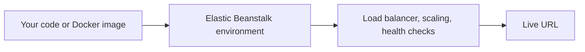
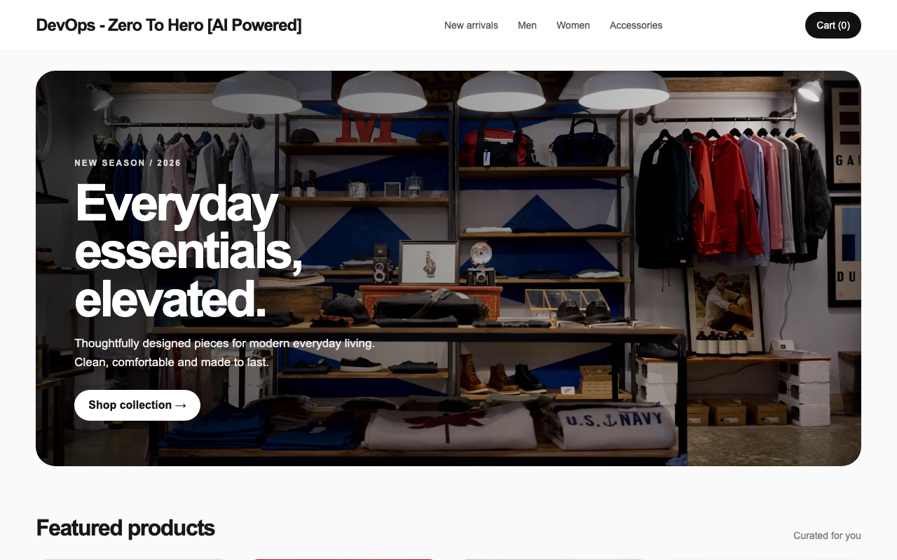
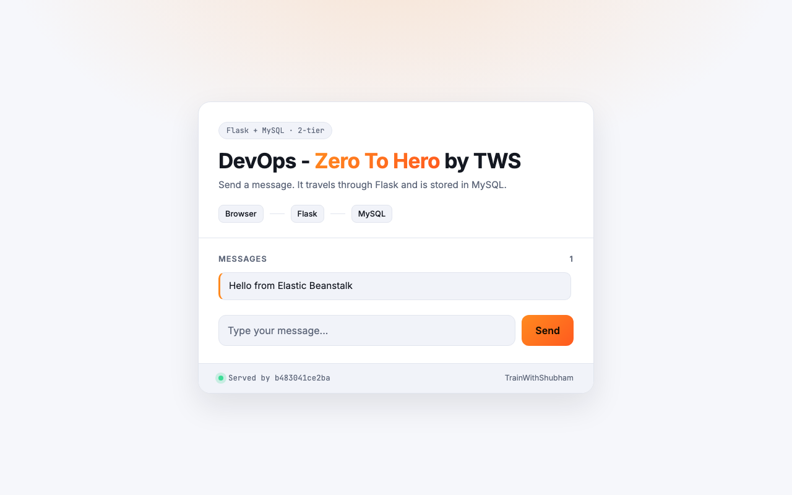
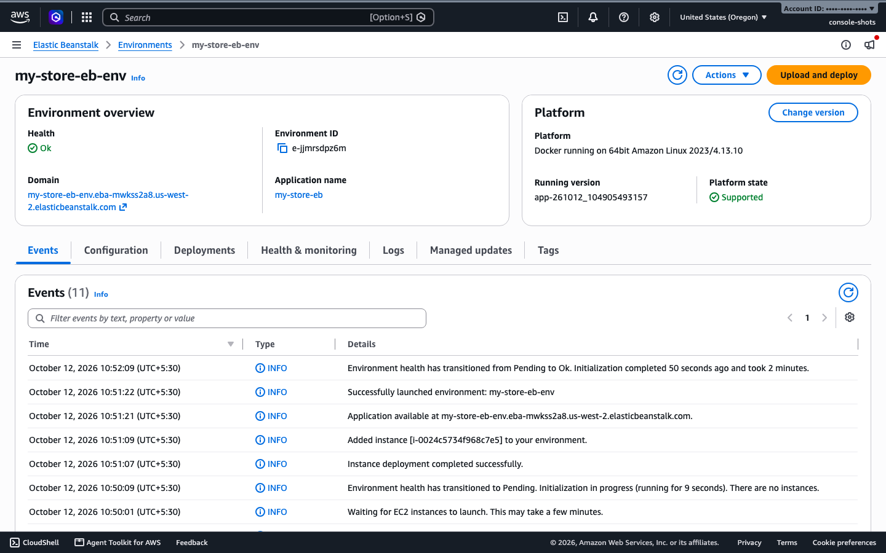

<h1 align="center">Amazon Elastic Beanstalk In One Shot</h1>

  Notes, tested commands and three live projects, in one place. 
  A free <b>TrainWithShubham</b> resource for the DevOps and Cloud community.

  
  
  
  
  
  

This is the companion repo for the video **Amazon Elastic Beanstalk In One Shot | 3 Live DevOps Projects | Beginners to Advanced**. It holds the chapter notes, the commands (each one run on a real account) and the project steps, so you can follow along or work through it on your own.

Elastic Beanstalk is a powerful PaaS on AWS. You bring the code (Java, .NET, Node.js, Python, PHP, Ruby, Go or Docker, no rewrite needed), and AWS handles provisioning, scaling, health monitoring, zero-downtime updates and automatic rollback.

## What you will build

| Project 1: Single-tier store | Project 2: Two-tier Flask + MySQL | Legacy PHP lift and shift |
|:---:|:---:|:---:|
|  |  |  |
| A public Docker Hub image and one file | App and database, Standard then Cluster Mode | An old PHP app, moved to a current platform |

Project 3 wires a GitHub Actions pipeline to Elastic Beanstalk, so every push deploys.

## What you will see in the console

  

Every project page has three ways to run each step: the console, the EB CLI and the AWS CLI. Pick the one you like.

## Quick start

| I want to | Go to |
|-----------|-------|
| Deploy something now | [Setup](setup/README.md) (tools, sign-in, IAM roles), then [Project 1](projects/project-1-single-tier.md) |
| Follow the video | The [chapter list](#chapters) below |
| Learn deployment strategies, scaling, monitoring | Chapters [5](notes/05-environments-config.md) to [8](notes/08-observability.md) |
| Show what I built (#BuildOnElasticBeanstalk) | [Community Projects](community/README.md) |
| Use this repo with an AI assistant | [SKILLS.md](SKILLS.md) |
| Avoid a surprise bill | [Cleanup and cost](notes/14-cleanup-and-cost.md) |

## Start here: the order to follow

1. Work through [setup/README.md](setup/README.md): AWS account, AWS CLI v2, EB CLI and the other tools, for macOS, Linux and Windows. It ends with a script that checks your machine.
2. Create the two IAM roles that Standard Mode needs: [setup/iam-roles.md](setup/iam-roles.md). This takes about 2 minutes and you do it once per AWS account.
3. Open Elastic Beanstalk and create your environment.
4. On the Service access step, pick the two roles from step 2.

Every project deploys the same way: a public Docker Hub image and one small file.

## Chapters

| # | Chapter | Notes |
|---|---------|-------|
| 1 | Course overview | [notes/01-course-overview.md](notes/01-course-overview.md) |
| 2 | Primitives and concepts | [notes/02-primitives-and-concepts.md](notes/02-primitives-and-concepts.md) |
| 3 | Console tour and AWS/IAM setup | [notes/03-console-tour-and-iam-setup.md](notes/03-console-tour-and-iam-setup.md) |
| 4 | Project 1: single-tier app (Standard Mode) | [notes/04-project-1-single-tier.md](notes/04-project-1-single-tier.md) |
| 5 | Environments, configuration, environment variables | [notes/05-environments-config.md](notes/05-environments-config.md) |
| 6 | Scaling and load balancing | [notes/06-scaling-load-balancing.md](notes/06-scaling-load-balancing.md) |
| 7 | Deployment strategies and automatic rollback | [notes/07-deployment-strategies.md](notes/07-deployment-strategies.md) |
| 8 | Observability | [notes/08-observability.md](notes/08-observability.md) |
| 9 | Cluster Mode: the operational upgrade | [notes/09-cluster-mode.md](notes/09-cluster-mode.md) |
| 10 | Project 2: two-tier Flask and MySQL app (Standard, then Cluster Mode) | [notes/10-project-2-two-tier.md](notes/10-project-2-two-tier.md) |
| 11 | Project 3: TWS Labs with CI/CD on GitHub Actions | [notes/11-project-3-cicd.md](notes/11-project-3-cicd.md) |
| 12 | Wrap-up and hackathon | [notes/12-wrap-up.md](notes/12-wrap-up.md) |
| 13 | Legacy apps: lift and shift | [notes/13-legacy-lift-and-shift.md](notes/13-legacy-lift-and-shift.md) |
| 14 | Cleanup and cost | [notes/14-cleanup-and-cost.md](notes/14-cleanup-and-cost.md) |

## Community Projects

Deployed your own app? Share a screenshot of it running and a link to your repo in [Community Projects](community/README.md). It is also how you take part in **#BuildOnElasticBeanstalk**.

## Projects

| Project | Source repo | Steps |
|---------|-------------|-------|
| 1. Single-tier store | [LondheShubham153/e-commerce-github-actions](https://github.com/LondheShubham153/e-commerce-github-actions) | [projects/project-1-single-tier.md](projects/project-1-single-tier.md) |
| 2. Two-tier Flask + MySQL app | [LondheShubham153/two-tier-flask-app](https://github.com/LondheShubham153/two-tier-flask-app) | [projects/project-2-two-tier.md](projects/project-2-two-tier.md) |
| 3. TWS Labs with CI/CD | [trainwithshubham/tws-labs](https://github.com/trainwithshubham/tws-labs) | [projects/project-3-cicd.md](projects/project-3-cicd.md) |

## Prerequisites

Everything is listed, with install steps for macOS, Linux and Windows, in [setup/README.md](setup/README.md). In short:

- An AWS account and an IAM user or role (not the root user) that can create Elastic Beanstalk environments and IAM roles
- AWS CLI v2, signed in, with the default region set to `us-west-2` (where the commands were tested)
- The EB CLI (`awsebcli`), Python 3, Git, curl, zip and openssl
- A bash-style shell: Terminal on macOS and Linux, WSL 2 or Git Bash on Windows
- A GitHub account for Project 3
- Docker (optional, for testing images locally)

Check your machine with `bash setup/check-setup.sh`.

Delete test environments when you finish to avoid charges.

## License

[MIT](LICENSE). Use the notes and commands freely, and tell your friends.
