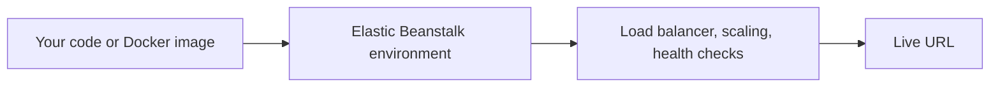
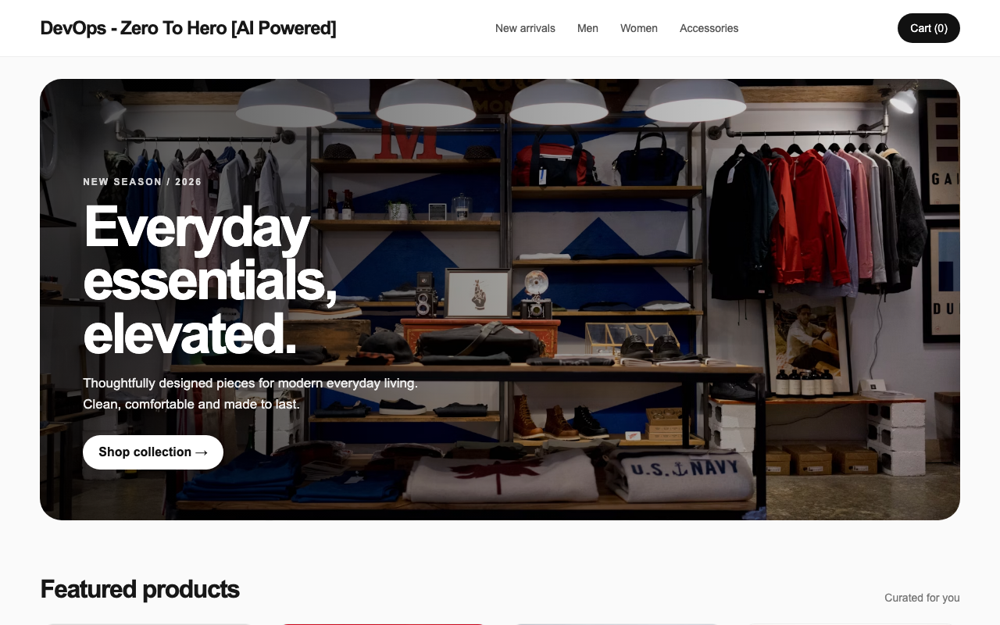
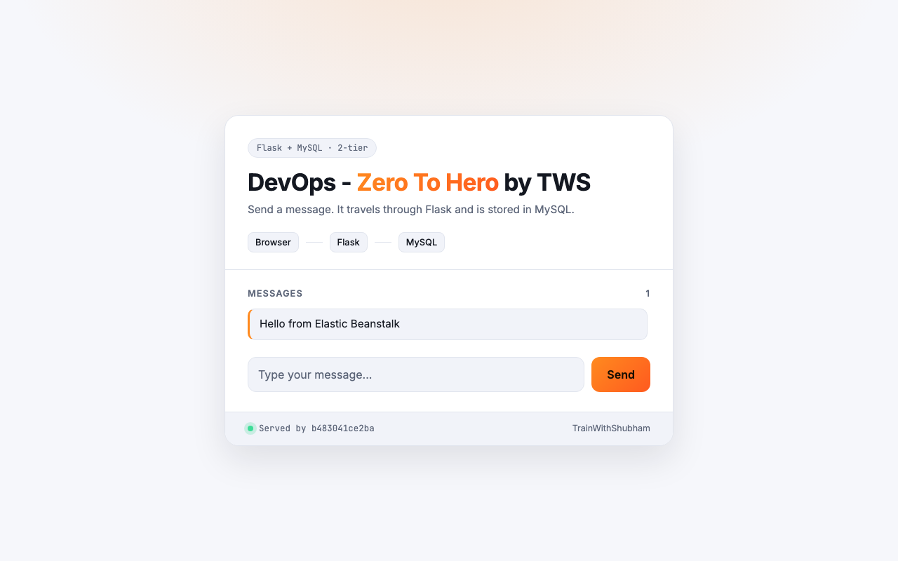
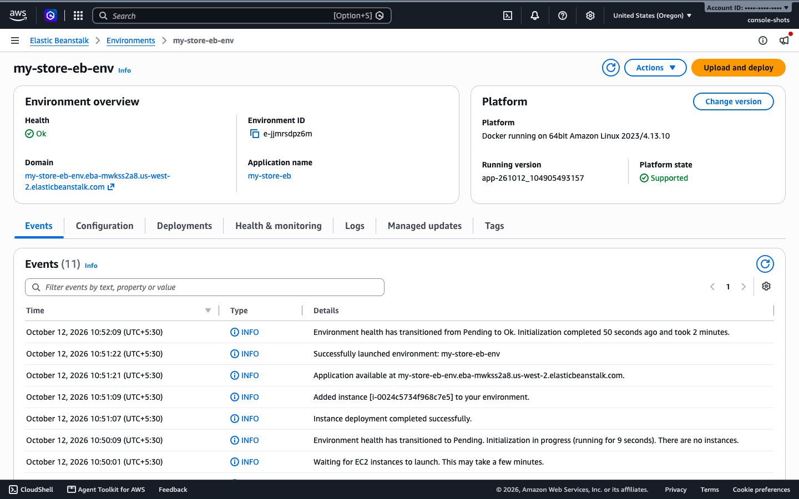

<h1 align="center">Amazon Elastic Beanstalk In One Shot</h1>

  Notes, tested commands and live projects to deploy real apps on AWS. 
  A free <b>TrainWithShubham</b> resource for the DevOps and Cloud community.

  
  
  
  
  

[Amazon Elastic Beanstalk](https://aws.amazon.com/elasticbeanstalk/) is a powerful PaaS on AWS. You bring the code (Java, .NET, Node.js, Python, PHP, Ruby, Go or Docker, no rewrite needed) and AWS handles provisioning, scaling, health monitoring, zero-downtime updates and automatic rollback.

This repo is the companion to the video **Amazon Elastic Beanstalk In One Shot | 3 Live DevOps Projects | Beginners to Advanced**. Every command was run on a real account, so you can follow along or work at your own pace.

## Start here

| I want to | Go to |
|---|---|
| Deploy my first app | [Setup](setup/README.md), then [Project 1](projects/project-1-single-tier.md) |
| Follow the video | [Chapters](#chapters) |
| Look up a command | [Cheatsheet](notes/cheatsheet.md) |
| Avoid a surprise bill | [Cleanup and cost](notes/14-cleanup-and-cost.md) |
| Get an idea for my own project | [Project ideas](community/project-ideas.md) |
| See what others built | [Community showcase](community/showcase.md) |
| Put my project on my resume | [Add it to your resume](community/add-to-resume.md) |
| Use this repo with an AI assistant | [SKILLS.md](SKILLS.md) |

## What you will build

| Single-tier store | Two-tier Flask + MySQL | Legacy PHP lift and shift |
|:---:|:---:|:---:|
|  |  |  |
| A public Docker Hub image and one file | App and database, Standard then Cluster Mode | An old PHP app moved to a current platform |

| Project | Source | Steps |
|---|---|---|
| 1. Single-tier store | [e-commerce-github-actions](https://github.com/LondheShubham153/e-commerce-github-actions) | [Guide](projects/project-1-single-tier.md) |
| 2. Two-tier Flask + MySQL | [two-tier-flask-app](https://github.com/LondheShubham153/two-tier-flask-app) | [Guide](projects/project-2-two-tier.md) |
| 3. CI/CD with GitHub Actions | [tws-labs](https://github.com/trainwithshubham/tws-labs) | [Guide](projects/project-3-cicd.md) |
| 4. Legacy lift and shift | [examples/legacy-php](examples/legacy-php) | [Guide](projects/legacy-lift-and-shift.md) |

Each step comes in three flavours: the console, the EB CLI and the AWS CLI. Pick the one you like.

  

## Setup in four steps

1. Install the tools and sign in: [setup/README.md](setup/README.md) covers macOS, Linux and Windows and ends with `bash setup/check-setup.sh`.
2. Create the two IAM roles Standard Mode needs, once per account: [setup/iam-roles.md](setup/iam-roles.md).
3. Open Elastic Beanstalk and create your environment.
4. On Service access, choose **Use another role** and pick the two roles from step 2.

You need an AWS account, AWS CLI v2, the EB CLI (`awsebcli`), Python 3, Git, curl, zip and openssl. Docker is optional.

## Chapters

| # | Chapter | # | Chapter |
|---|---|---|---|
| 1 | [Course overview](notes/01-course-overview.md) | 8 | [Observability](notes/08-observability.md) |
| 2 | [Primitives and concepts](notes/02-primitives-and-concepts.md) | 9 | [Cluster Mode](notes/09-cluster-mode.md) |
| 3 | [Console tour and IAM setup](notes/03-console-tour-and-iam-setup.md) | 10 | [Project 2: two-tier app](notes/10-project-2-two-tier.md) |
| 4 | [Project 1: single-tier app](notes/04-project-1-single-tier.md) | 11 | [Project 3: CI/CD](notes/11-project-3-cicd.md) |
| 5 | [Environments and configuration](notes/05-environments-config.md) | 12 | [Wrap-up and hackathon](notes/12-wrap-up.md) |
| 6 | [Scaling and load balancing](notes/06-scaling-load-balancing.md) | 13 | [Legacy lift and shift](notes/13-legacy-lift-and-shift.md) |
| 7 | [Deployment strategies and rollback](notes/07-deployment-strategies.md) | 14 | [Cleanup and cost](notes/14-cleanup-and-cost.md) |

## Community

27 builders deployed their own apps for **#BuildOnElasticBeanstalk**: incident platforms, FinOps dashboards, AI helpers and civic tools. Browse them in the [showcase](community/showcase.md), then [add yours](community/README.md#how-to-submit).

| | |
|---|---|
| [Showcase](community/showcase.md) | Every project, with the builder, the repo and their LinkedIn posts |
| [Project ideas](community/project-ideas.md) | Five levels, from a first deploy to platform tooling |
| [Add it to your resume](community/add-to-resume.md) | Bullets, a LinkedIn post template and a repo checklist |

## Contributing

Found a typo or a command that failed on your setup? Open an [issue](../../issues) or a pull request. Built something? Use the [community form](../../issues/new?template=community-project.yml).

Delete test environments when you finish to avoid charges.

## License

[MIT](LICENSE). Use the notes and commands freely, and tell your friends.
