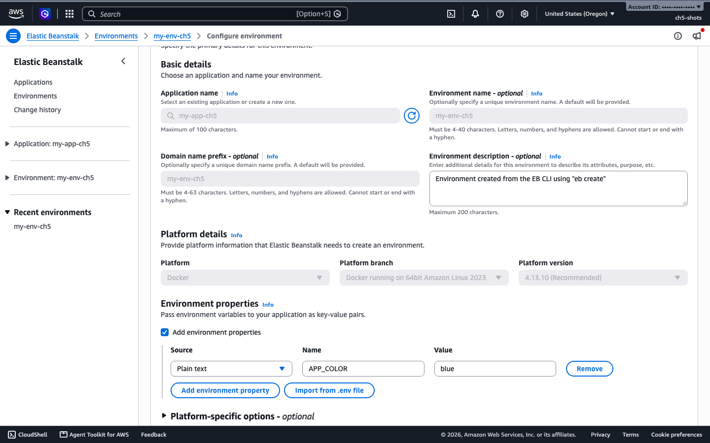
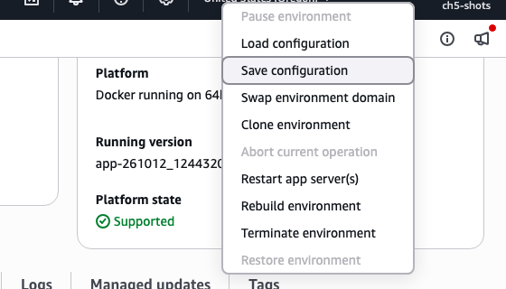
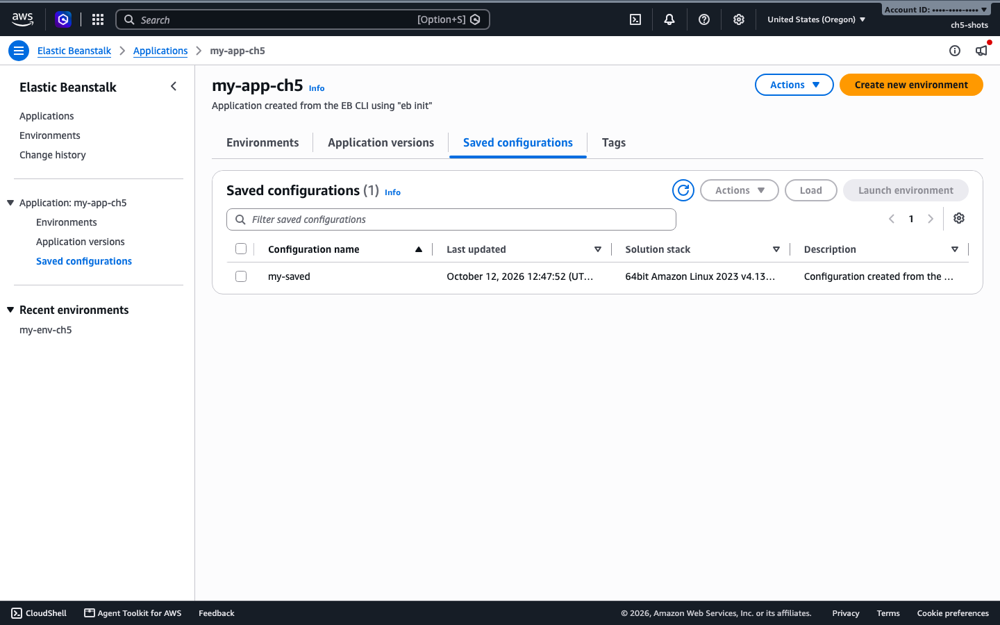

# 5. Environments, configuration and environment variables

An application is the folder. An environment is one running copy of it, with its own URL, instances and settings. This chapter covers how settings work: environment variables, saved configurations, and the `.ebextensions` and `.platform` folders.

All commands were run on a load-balanced Standard Mode environment in `us-west-2` (Docker on 64bit Amazon Linux 2023 v4.13.10, `t3.micro`, 2 to 4 instances). Setup page: [setup/iam-roles.md](../setup/iam-roles.md).

## At a glance

| What you will do | Time | Cost and risk |
|------------------|------|---------------|
| Create a load-balanced environment | 3 min 17 s | 2 instances and a load balancer while it runs |
| Change an environment variable | 83 s | The app restarts on each instance |
| Save the configuration and reuse it | seconds to save, 4 min to launch a copy | A second environment costs the same as the first |
| Deploy a bundle with `.ebextensions` | 82 s | None beyond the environment |

## How settings work

Every setting is an option in a namespace, such as `aws:autoscaling:asg` / `MinSize`. You can set an option in the console, with the EB CLI, with the AWS CLI, in a saved configuration, or in a file inside your bundle. When the same option is set in more than one place, the order from lowest to highest is: platform defaults, saved configuration, `.ebextensions` files, then settings made directly on the environment.

## Create the environment used in this chapter

Save this as `opts.json`:

```json
[
 {"Namespace":"aws:autoscaling:launchconfiguration","OptionName":"IamInstanceProfile","Value":"aws-elasticbeanstalk-ec2-role"},
 {"Namespace":"aws:elasticbeanstalk:environment","OptionName":"ServiceRole","Value":"aws-elasticbeanstalk-service-role"},
 {"Namespace":"aws:elasticbeanstalk:environment","OptionName":"EnvironmentType","Value":"LoadBalanced"},
 {"Namespace":"aws:elasticbeanstalk:environment","OptionName":"LoadBalancerType","Value":"application"},
 {"Namespace":"aws:ec2:instances","OptionName":"InstanceTypes","Value":"t3.micro"},
 {"Namespace":"aws:autoscaling:asg","OptionName":"MinSize","Value":"2"},
 {"Namespace":"aws:autoscaling:asg","OptionName":"MaxSize","Value":"4"},
 {"Namespace":"aws:elasticbeanstalk:environment:process:default","OptionName":"HealthCheckPath","Value":"/health"},
 {"Namespace":"aws:elasticbeanstalk:healthreporting:system","OptionName":"SystemType","Value":"enhanced"}
]
```

Then create the application version from the Project 1 compose file (see [Project 1](../projects/project-1-single-tier.md)) and the environment:

```bash
aws elasticbeanstalk create-environment --application-name my-app \
  --environment-name my-env --version-label v1 \
  --solution-stack-name "64bit Amazon Linux 2023 v4.13.10 running Docker" \
  --option-settings file://opts.json
```

This was Ready and Green in 3 minutes 17 seconds, with 2 instances behind an Application Load Balancer. The same file works for every other command in chapters 5 to 8.

## Environment variables

### Run it with the console

1. Open the environment, then the **Configuration** tab.
2. In the first card, **Environment details**, choose **Edit**.
3. Scroll to **Environment properties**, choose **Add environment property**, enter `APP_COLOR` and `blue`, then choose **Save changes** at the bottom of the page.



The screenshot shows the page for an environment that already has `APP_COLOR=blue`. I did not click **Save changes** in the console, so that last step follows the page layout. The AWS CLI and EB CLI routes below were run for real.

### Run it with the EB CLI

```bash
eb setenv APP_COLOR=red     # sets it
eb printenv                 # lists it
```

Tested. `eb setenv` waits for the update to finish. On a three-instance environment with a slow deployment policy this took 244 seconds, and the EB CLI gave up waiting after 4 minutes even though the update carried on. Run `eb events -f` to keep watching.

### Run it with the AWS CLI

```bash
aws elasticbeanstalk update-environment --environment-name my-env \
  --option-settings Namespace=aws:elasticbeanstalk:application:environment,OptionName=APP_COLOR,Value=blue
```

Result: Ready again in 83 seconds. The containers were recreated, so each instance got a new container ID.

### Use the variable in a compose file

With Docker Compose on Elastic Beanstalk, the variable reaches your container through substitution:

```yaml
services:
  app:
    image: your-image:1.0.0
    environment:
      APP_COLOR: ${APP_COLOR:-unset}
```

To test it, a tiny Python echo container printed `color=blue` after the update above, on both instances.

### Check it works

```bash
aws elasticbeanstalk describe-configuration-settings --application-name my-app \
  --environment-name my-env \
  --query "ConfigurationSettings[0].OptionSettings[?Namespace=='aws:elasticbeanstalk:application:environment'].[OptionName,Value]" \
  --output text
```

Expected: `APP_COLOR   blue`.

Cluster Mode is different. It takes all variables as one JSON option called `env-variables` in the `aws:elasticbeanstalk:eks:environment` namespace. See [chapter 9](09-cluster-mode.md) and [Project 2](../projects/project-2-two-tier.md).

## Saved configurations

A saved configuration is a snapshot of an environment's settings. You can launch a new environment from it.

### Run it with the EB CLI

```bash
eb config save my-env --cfg my-saved
```

Tested. It wrote `.elasticbeanstalk/saved_configs/my-saved.cfg.yml` next to your project, and it also stored the configuration on Elastic Beanstalk.

### Run it with the AWS CLI

```bash
EID=$(aws elasticbeanstalk describe-environments --environment-names my-env \
  --query 'Environments[0].EnvironmentId' --output text)
aws elasticbeanstalk create-configuration-template --application-name my-app \
  --template-name my-saved --environment-id $EID

aws elasticbeanstalk create-environment --application-name my-app \
  --environment-name my-env-copy --template-name my-saved --version-label v2 \
  --option-settings Namespace=aws:autoscaling:asg,OptionName=MinSize,Value=1
```

The copy took 4 minutes 5 seconds to reach Ready and Green. Options you pass on the command line win over the saved ones, so the copy ran 1 instance instead of 2.

### Run it with the console

Open the environment, choose **Actions**, then **Save configuration**.



To use it, open the application, choose the **Saved configurations** tab, select your configuration and choose **Launch environment**.



The two screenshots come from a configuration saved with the EB CLI. I did not click through the **Save configuration** dialog or **Launch environment** in the console.

## `.ebextensions` and `.platform` folders

These are folders you put inside the bundle you upload. They are the one reason to use a ZIP. A working example is in [examples/ebextensions-demo](../examples/ebextensions-demo/):

```
docker-compose.yml
.ebextensions/01-options.config
.platform/hooks/postdeploy/01-hello.sh
```

`.ebextensions/01-options.config` sets an environment property and the health check path:

```yaml
option_settings:
  aws:elasticbeanstalk:application:environment:
    STORE_NAME: Nova
  aws:elasticbeanstalk:environment:process:default:
    HealthCheckPath: /health
```

`.platform/hooks/postdeploy/01-hello.sh` is a script that runs on every instance after each deploy. Make it executable.

### Run it with the AWS CLI

```bash
cd examples/ebextensions-demo
zip -r ../ebextensions-demo.zip . -x README.md
BUCKET=$(aws elasticbeanstalk create-storage-location --query S3Bucket --output text)
aws s3 cp ../ebextensions-demo.zip s3://$BUCKET/my-app/ebextensions-demo.zip
aws elasticbeanstalk create-application-version --application-name my-app \
  --version-label ext --source-bundle S3Bucket=$BUCKET,S3Key=my-app/ebextensions-demo.zip
aws elasticbeanstalk update-environment --environment-name my-env --version-label ext
```

Ready again in 82 seconds.

### Run it with the EB CLI

Copy the contents of the example folder into your EB CLI project and run `eb deploy`. The EB CLI zips the folder for you. Not run separately for this example.

### Check it works

```bash
aws elasticbeanstalk describe-configuration-settings --application-name my-app \
  --environment-name my-env \
  --query "ConfigurationSettings[0].OptionSettings[?OptionName=='STORE_NAME'||OptionName=='HealthCheckPath'].[OptionName,Value]" \
  --output text
```

Expected: `STORE_NAME   Nova` and `HealthCheckPath   /health`. To see the hook run, fetch the log tail (see [chapter 8](08-observability.md)) and search for `ch5 demo hook`. The line was in `/var/log/eb-hooks.log` on the instance.

## Clean up

```bash
aws elasticbeanstalk terminate-environment --environment-name my-env
aws elasticbeanstalk delete-configuration-template --application-name my-app --template-name my-saved
aws elasticbeanstalk delete-application --application-name my-app
```

Remove the files you uploaded to the S3 bucket too if you do not need them.

## Common problems

- Nginx files under `.platform/nginx/` had no effect in our test of a compose deployment that publishes port 80. The container owns the port, so there is no proxy to configure. When we moved the container to 8080 to test that, the load balancer returned 502. Leave nginx extensions out of compose deployments.
- A scheduled action name must be alphanumeric. See [chapter 6](06-scaling-load-balancing.md).
- `eb setenv` can time out on slow deployment policies. The update is still running, so check `eb events -f`.
- An environment created with the API starts with all-at-once deployments and managed updates off. See [chapter 7](07-deployment-strategies.md).
