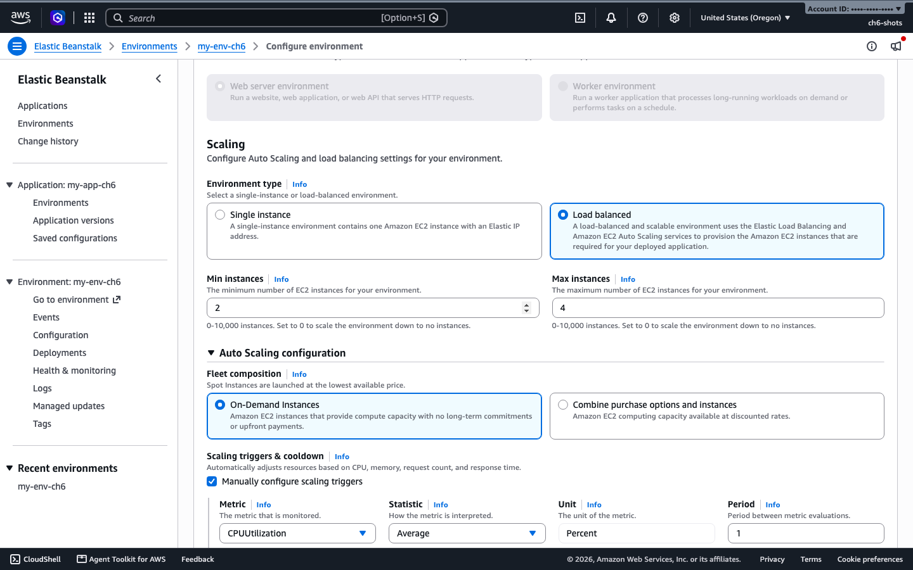
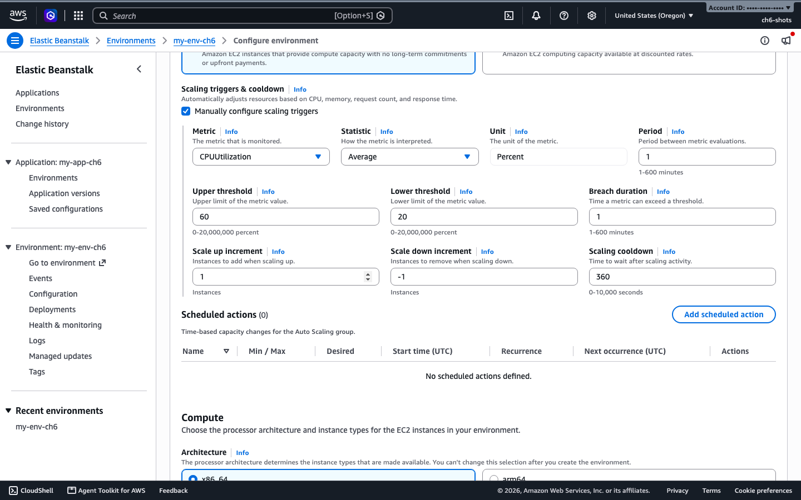
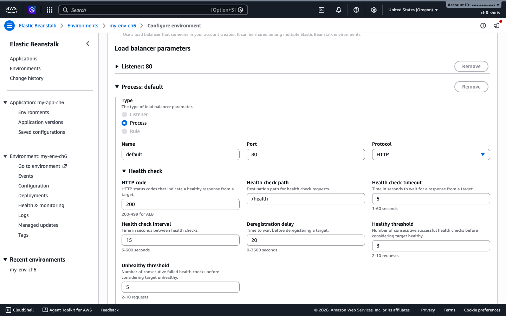

# 6. Scaling and load balancing

A load-balanced environment runs an Application Load Balancer in front of an Auto Scaling group. You set the minimum and maximum number of instances, and Elastic Beanstalk adds or removes instances inside that range. This chapter changes the range, adds a CPU trigger, schedules a change, and checks the load balancer health check.

Same environment as [chapter 5](05-environments-config.md): `t3.micro`, minimum 2, maximum 4, `us-west-2`.

## At a glance

| What you will do | Time | Cost and risk |
|------------------|------|---------------|
| Raise the minimum from 2 to 3 instances | 97 s | One more instance billed |
| Change the scaling trigger to CPU | about 1 min | Alarms are created for you |
| Add a scheduled scaling action | fires at the time you set | None |
| Read the load balancer health check | seconds | None |

## How scaling is set up

Two alarms in CloudWatch drive it. A high alarm adds instances, a low alarm removes them. By default the metric is `NetworkOut`, with an upper threshold of 6,000,000 bytes and a lower threshold of 2,000,000 bytes over 5 minutes. Most apps are better served by CPU. A scheduled action changes the minimum, maximum and desired size at a time you choose.

## Change the minimum and maximum

### Run it with the console

1. Open the environment, then the **Configuration** tab.
2. In the **Infrastructure** card choose **Edit**.
3. Under **Scaling**, set **Min instances** and **Max instances**, then choose **Save changes** at the bottom of the page.



The screenshot is the real page for the environment in this chapter. I did not click **Save changes** in the console, so the final step follows the page layout. The CLI routes below were run for real.

### Run it with the EB CLI

```bash
eb scale 2
```

Tested. It sets both the minimum and the maximum to 2, so the group stops scaling in either direction. It took 204 seconds on a 3-instance environment.

### Run it with the AWS CLI

```bash
aws elasticbeanstalk update-environment --environment-name my-env \
  --option-settings Namespace=aws:autoscaling:asg,OptionName=MinSize,Value=3
```

Result: going from 2 to 3 instances took 97 seconds, and all three reported `Ok`.

### Check it works

```bash
aws elasticbeanstalk describe-environment-resources --environment-name my-env \
  --query 'length(EnvironmentResources.Instances)' --output text
aws elasticbeanstalk describe-instances-health --environment-name my-env \
  --attribute-names HealthStatus --query 'InstanceHealthList[].[InstanceId,HealthStatus]' --output text
```

## Scale on CPU

Save as `scale.json`:

```json
[
 {"Namespace":"aws:autoscaling:trigger","OptionName":"MeasureName","Value":"CPUUtilization"},
 {"Namespace":"aws:autoscaling:trigger","OptionName":"Statistic","Value":"Average"},
 {"Namespace":"aws:autoscaling:trigger","OptionName":"Unit","Value":"Percent"},
 {"Namespace":"aws:autoscaling:trigger","OptionName":"UpperThreshold","Value":"60"},
 {"Namespace":"aws:autoscaling:trigger","OptionName":"LowerThreshold","Value":"20"},
 {"Namespace":"aws:autoscaling:trigger","OptionName":"Period","Value":"1"},
 {"Namespace":"aws:autoscaling:trigger","OptionName":"BreachDuration","Value":"1"}
]
```

```bash
aws elasticbeanstalk update-environment --environment-name my-env --option-settings file://scale.json
```

In the console, it is the same **Infrastructure** card. Under **Scaling**, open **Auto Scaling configuration** and tick **Manually configure scaling triggers**. The page below shows the values from the file above, applied with the AWS CLI. **Scheduled actions** sit right under it.



### Check it works

```bash
aws cloudwatch describe-alarms --alarm-name-prefix awseb-e- \
  --query "MetricAlarms[].[AlarmName,MetricName,Threshold,Period,ComparisonOperator]" --output text
```

Result: the two alarms switched from `NetworkOut` to `CPUUtilization`, with a period of 60 seconds.

### What a real scale-out looks like

Our test app is too light to push a `t3.micro` past a few percent CPU. 40 parallel request loops for four minutes held average CPU at about 0.6%. To see the trigger fire, we lowered the upper threshold to 0.3 (a test value, not a recommendation):

- The alarm went into `ALARM` about 94 seconds after the update.
- Auto Scaling added an instance 386 seconds after the update, because a new policy waits out a cooldown of several minutes.
- The activity log read: alarm in state ALARM triggered the scale-up policy, changing the desired capacity from 2 to 3.

Expect a scale-out to take several minutes, not seconds. For sudden traffic, keep the minimum high enough to cope.

## Scheduled actions

A scheduled action changes the group size at a fixed time. This one scales in to 2 instances at a chosen time. The name has to be alphanumeric.

```bash
ST=$(date -u -v+6M +%Y-%m-%dT%H:%M:%SZ)     # macOS. On Linux: date -u -d '+6 min' +%Y-%m-%dT%H:%M:%SZ
aws elasticbeanstalk update-environment --environment-name my-env --option-settings \
  Namespace=aws:autoscaling:scheduledaction,ResourceName=ScaleIn,OptionName=MinSize,Value=2 \
  Namespace=aws:autoscaling:scheduledaction,ResourceName=ScaleIn,OptionName=MaxSize,Value=4 \
  Namespace=aws:autoscaling:scheduledaction,ResourceName=ScaleIn,OptionName=DesiredCapacity,Value=2 \
  Namespace=aws:autoscaling:scheduledaction,ResourceName=ScaleIn,OptionName=StartTime,Value=$ST
```

Check it:

```bash
ASG=$(aws elasticbeanstalk describe-environment-resources --environment-name my-env \
  --query 'EnvironmentResources.AutoScalingGroups[0].Name' --output text)
aws autoscaling describe-scheduled-actions --auto-scaling-group-name $ASG \
  --query 'ScheduledUpdateGroupActions[].[ScheduledActionName,StartTime,MinSize,MaxSize,DesiredCapacity]' --output text
```

Result: the action fired on time. The group went from 3 instances to 2 about 10 seconds after the start time. Use `Recurrence` with a cron expression instead of `StartTime` for a daily or weekly schedule.

## Load balancer and health check

The environment uses an Application Load Balancer. It sends a request to the health check path on every instance and stops sending traffic to an instance that fails. Set the path to a cheap endpoint that returns 200 only when the app is fine. The store app has `/health`.

```bash
aws elasticbeanstalk describe-configuration-settings --application-name my-app \
  --environment-name my-env \
  --query "ConfigurationSettings[0].OptionSettings[?OptionName=='HealthCheckPath'].[Value]" --output text
```

Expected: `/health`. In the console it is in the **Networking** card: choose **Edit**, then under **Load balancer parameters** open **Process: default** and **Health check**.



## Clean up

Delete the environment when you finish ([chapter 5](05-environments-config.md#clean-up)). Scheduled actions and alarms are removed with it.

## Common problems

- `eb scale 2` also sets the maximum to 2. Use the AWS CLI if you want a range.
- A scheduled action named `ch5-scale-in` is rejected. Use letters and digits only.
- Setting `MinSize` again in an update overrides what a scheduled action did earlier. Include the value you want in the same update.
- A load test from one laptop may not raise CPU on the instances. Check CloudWatch before you assume the trigger is wrong.
- The alarm can sit in `ALARM` for minutes before Auto Scaling acts.
