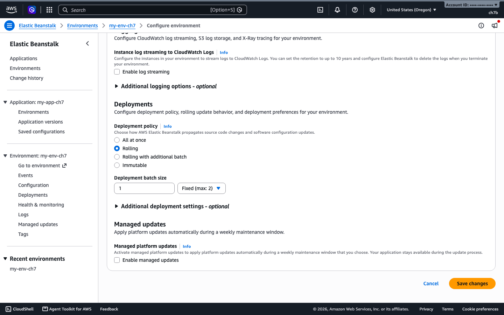
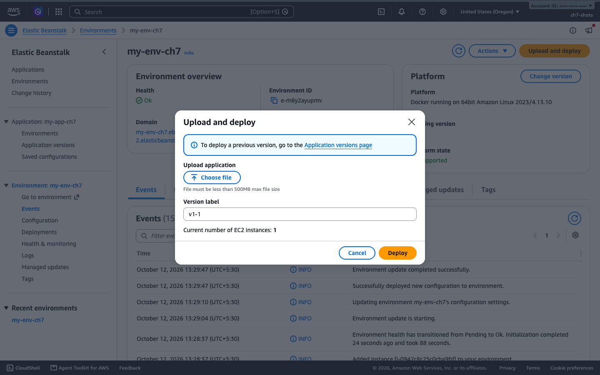
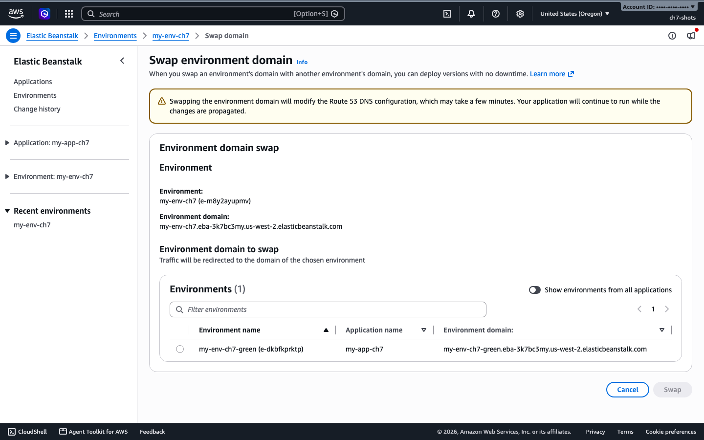

# 7. Deployment strategies, blue/green and rollback

A deployment policy decides how a new version reaches your instances. Pick it by how much downtime you can accept and how much extra capacity you are willing to pay for. This chapter runs each policy against the same environment, swaps two environments for a blue/green release, and shows what happens when a deployment fails.

Same environment as [chapter 5](05-environments-config.md): 3 instances behind an Application Load Balancer. The two versions were a small echo container that prints `version=v1` or `version=v2` and its host name, so each request showed which version answered. A request loop hit the environment URL about twice a second during every test.

## At a glance

| What you will do | Time | Cost and risk |
|------------------|------|---------------|
| Try each deployment policy | 45 s to 21 min each | Immutable and rolling with an extra batch add instances for a while |
| Swap two environments (blue/green) | 5 s for the swap, 4 min to build the second environment | A second environment while both run |
| Break a deployment on purpose | 4 min | None, the old version keeps serving |
| Roll back | 41 s | None |

## The policies

| Policy | How it works | Time until Ready | Requests with no valid answer |
|--------|--------------|------------------|--------------------------------|
| All at once | Updates every instance together | 45 s | 30 of 69 |
| Rolling | Updates a batch (here 1 instance) at a time | 9 min 13 s | 1 of 485 |
| Rolling with additional batch | Adds a new batch first, then updates the rest | 12 min 29 s | 0 of 664 |
| Immutable | Launches new instances in a temporary group, swaps them in | 20 min 49 s | 1 of 1,098 |
| Traffic splitting | Immutable, plus a share of traffic goes to the new version first | 11 min 11 s | 36 of 626 |

One run each, from a laptop, so treat the numbers as an order of magnitude. Times are until the environment showed Ready. The slower policies also remove old instances a few minutes apart, and the clock includes that.

What the numbers say:

- All at once is the fastest and the only one that is clearly down. For about 30 seconds the load balancer had no healthy instance and answered with an error page or nothing.
- Rolling and immutable kept serving. The single failed request in each could be a blip. Treat both as zero-downtime.
- Rolling with an extra batch never dropped below full capacity.
- Traffic splitting, set to send 50% to the new version for 5 minutes, had the most failed requests in our run, and the environment turned Red for a while with the cause "5.7 % of the requests to the ELB are failing with HTTP 5xx". We did not find out why. Test it with your own app before you rely on it.

## Set a policy and deploy

### Run it with the console

1. Open the environment, then the **Configuration** tab.
2. In the **Monitoring and updates** card choose **Edit**.
3. Scroll to **Deployments**. Choose the **Deployment policy** and, for the rolling policies, the **Deployment batch size**. Choose **Save changes**.



4. To deploy a version, choose **Upload and deploy** at the top of the environment page, pick a file, and give it a version label.



The policy page lists All at once, Rolling, Rolling with additional batch and Immutable, with Rolling selected here. I did not find traffic splitting on this page, so set it with the AWS CLI below. A single-instance environment only offers All at once and Immutable, so the screenshot comes from a load-balanced one. I did not click **Save changes** or **Deploy** in the console. The CLI routes were run for real.

### Run it with the EB CLI

```bash
eb deploy                    # deploys the current folder with the policy already set
eb deploy --version v2       # deploys a version that already exists
```

Tested. `eb deploy --version` took 41 seconds with all at once. The EB CLI does not set the policy itself in these commands. Set it in the console, the AWS CLI, or an `.ebextensions` file.

### Run it with the AWS CLI

All at once, rolling and rolling with an extra batch use the same pattern. Immutable has no batch settings.

```bash
aws elasticbeanstalk update-environment --environment-name my-env --version-label v2 \
  --option-settings \
    Namespace=aws:elasticbeanstalk:command,OptionName=DeploymentPolicy,Value=Rolling \
    Namespace=aws:elasticbeanstalk:command,OptionName=BatchSizeType,Value=Fixed \
    Namespace=aws:elasticbeanstalk:command,OptionName=BatchSize,Value=1
```

Replace `Rolling` with `AllAtOnce`, `RollingWithAdditionalBatch`, `Immutable` or `TrafficSplitting`. For traffic splitting add:

```
Namespace=aws:elasticbeanstalk:trafficsplitting,OptionName=NewVersionPercent,Value=50
Namespace=aws:elasticbeanstalk:trafficsplitting,OptionName=EvaluationTime,Value=5
```

Wait until it finishes:

```bash
aws elasticbeanstalk describe-environments --environment-names my-env \
  --query 'Environments[0].[Status,Health,VersionLabel]' --output text
```

The setting is stored on the environment, so it also applies to later configuration changes. Changing an environment variable while the policy was traffic splitting took over four minutes.

A policy you create with the API starts as all at once, with a batch size of 100%. Check yours:

```bash
aws elasticbeanstalk describe-configuration-settings --application-name my-app --environment-name my-env \
  --query "ConfigurationSettings[0].OptionSettings[?OptionName=='DeploymentPolicy'].Value" --output text
```

## Blue/green with a swap

Create a second environment from a saved configuration ([chapter 5](05-environments-config.md#saved-configurations)), deploy the new version to it, test it on its own URL, then swap the URLs.

```bash
aws elasticbeanstalk create-environment --application-name my-app \
  --environment-name my-env-green --template-name my-saved --version-label v2

aws elasticbeanstalk swap-environment-cnames \
  --source-environment-name my-env --destination-environment-name my-env-green
```

Results: the second environment took 4 minutes 5 seconds to become Ready. The swap was Ready again in 5 seconds. A request loop on the production URL ran for 120 seconds across the swap. It had zero failed requests, and the answer changed from `version=v1` to `version=v2` in a single step.

The two environments keep their names and swap their URLs, so check `describe-environments` before you delete the "old" one. To roll back, swap again. In the console this is **Actions**, then **Swap environment domain**. Choose the other environment from the list and choose **Swap**.



I opened this page but did not click **Swap** in the console. The AWS CLI swap above was run for real.

## What happens when a deployment fails

We deployed a version that points at an image tag that does not exist, with the immutable policy and a command timeout of 180 seconds:

```bash
aws elasticbeanstalk update-environment --environment-name my-env --version-label bad \
  --option-settings \
    Namespace=aws:elasticbeanstalk:command,OptionName=DeploymentPolicy,Value=Immutable \
    Namespace=aws:elasticbeanstalk:command,OptionName=Timeout,Value=180
```

Result after 4 minutes 18 seconds:

- The deployment failed with `Unsuccessful command execution on instance id(s) ... Aborting the operation`.
- Elastic Beanstalk terminated the new instances and the temporary Auto Scaling group.
- The environment stayed on the previous version. All 233 requests sent during the test were answered by `version=v1`.

So the rollback is automatic for immutable deployments, because the old instances never stopped. We did not run a bad version through all at once, which updates every instance together, so plan on a manual rollback there.

## Roll back on purpose

Redeploy the previous version. In the console, the **Upload and deploy** dialog links to the **Application versions** page, where you pick the old version and deploy it.

```bash
aws elasticbeanstalk update-environment --environment-name my-env --version-label v1
# or
eb deploy --version v1
```

41 seconds with all at once. List your versions with `aws elasticbeanstalk describe-application-versions --application-name my-app --query 'ApplicationVersions[].VersionLabel' --output text`.

## Check it works

During any deployment, poll the URL and watch which version answers:

```bash
while true; do curl -s -m 2 http://<your-environment-cname>/ ; sleep 0.5; done
```

Afterwards check the Events tab, or:

```bash
aws elasticbeanstalk describe-events --environment-name my-env --max-items 8 \
  --query 'Events[].[EventDate,Severity,Message]' --output text
```

## Clean up

Terminate both environments and delete the application ([chapter 5](05-environments-config.md#clean-up)).

## Common problems

- After a swap, `my-env` holds the other URL. Look at the CNAME column before you terminate anything.
- A rolling or immutable deployment of a large environment can take 10 to 20 minutes. All at once is fast because it is the one that can go down.
- Immutable and rolling with an extra batch need room in your instance and vCPU limits for the extra instances.
- A failed deployment is easy to miss on the dashboard. Check the Events tab for `Failed to deploy application`.
- Do not use `Timeout=180` in production. We shortened it so the failure arrived sooner.
