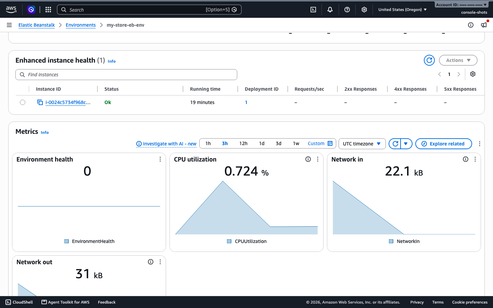
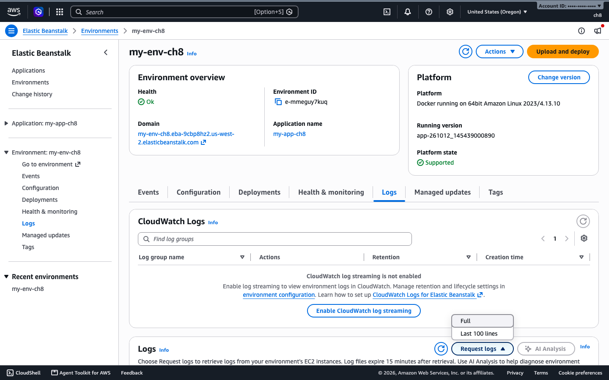
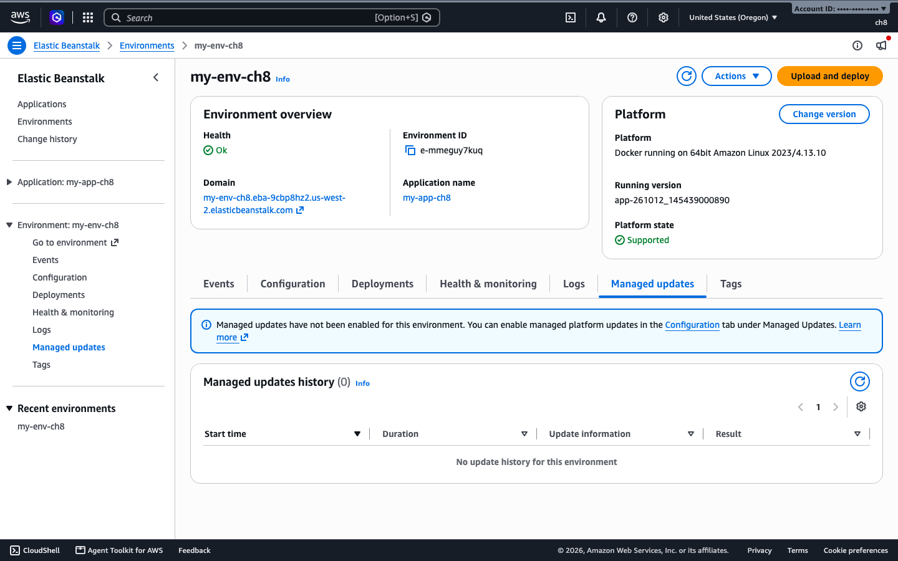

# 8. Observability: health, metrics, logs and managed updates

Elastic Beanstalk watches your environment and tells you what is wrong in plain words. This chapter reads health colors and causes, pulls CloudWatch metrics, fetches logs from the instances, and turns on managed platform updates.

Same environment as [chapter 5](05-environments-config.md). Everything here was run in `us-west-2`.

## At a glance

| What you will do | Time | Cost and risk |
|------------------|------|---------------|
| Read environment and instance health | seconds | None |
| Read CloudWatch metrics | seconds | None |
| Fetch the last lines of the logs | about 25 s | None |
| Fetch the full log bundle | about 45 s | None |
| Turn on managed platform updates | about 1 min | AWS may restart instances in your maintenance window |

## Health

Enhanced health reporting is on when you create an environment in the console, and in our `opts.json` from chapter 5. It watches the instances, the load balancer and your app's HTTP status codes. Basic health only looks at the load balancer and the instances' status.

| Color | Meaning |
|-------|---------|
| Green | Ok |
| Yellow | Warning, something needs a look |
| Red | Degraded or severe, many requests failing or instances not responding |
| Grey | No data, or the update is in progress |

The causes tell you why. We saw these in the test runs:

- `Application update completed 20 seconds ago and took 9 minutes.`
- `Application update is aborting (running for 63 seconds).` (during the failed deployment in [chapter 7](07-deployment-strategies.md))
- `5.7 % of the requests to the ELB are failing with HTTP 5xx (4 minutes ago).` The environment was Red with status Degraded after a deployment that returned errors for a short time.

### Run it with the console

Open the environment. The **Health** badge is on the overview. The **Health & monitoring** tab lists each instance with its status, running time, deployment ID, request counts and response codes, with charts underneath.



### Run it with the EB CLI

```bash
eb status     # status, health color, URL
eb health     # one line per instance, with counts of ok, warning, degraded, severe
```

Tested. `eb health` printed the environment as `Ok`, one instance row per server, and a cause line such as `Application update completed 7 seconds ago and took 25 seconds.`

### Run it with the AWS CLI

```bash
aws elasticbeanstalk describe-environment-health --environment-name my-env \
  --attribute-names All
aws elasticbeanstalk describe-instances-health --environment-name my-env \
  --attribute-names All
```

On the healthy environment the second command returned `Ok`, `Green`, no causes, user CPU 0.4%, idle 99.6% and a load average of 0.05 for the first instance. The first returned the counts of instances in each state and the request count for the last minute.

### Basic versus enhanced

We switched the same environment to basic reporting with:

```bash
aws elasticbeanstalk update-environment --environment-name my-env --option-settings \
  Namespace=aws:elasticbeanstalk:healthreporting:system,OptionName=SystemType,Value=basic
```

Afterwards both `describe-environment-health` and `describe-instances-health` answered `is not supported`, and the environment showed Grey with no health status. Keep enhanced on.

## Metrics in CloudWatch

Elastic Beanstalk publishes an `EnvironmentHealth` metric in the `AWS/ElasticBeanstalk` namespace. Instance CPU is in `AWS/EC2`, and request counts are on the load balancer in `AWS/ApplicationELB`.

```bash
aws cloudwatch get-metric-statistics --namespace AWS/ElasticBeanstalk \
  --metric-name EnvironmentHealth --dimensions Name=EnvironmentName,Value=my-env \
  --start-time $(date -u -v-2H +%FT%TZ) --end-time $(date -u +%FT%TZ) \
  --period 3600 --statistics Maximum --query 'Datapoints[].[Timestamp,Maximum]' --output text
```

On Linux, replace `-v-2H` with `-d '2 hours ago'`.

The metric is a number, with 0 for Ok and bigger numbers for worse states. Our run showed a maximum of `1` in the quiet hour and `20` in the hour with the failing deployment, and 20 is the value for degraded.

CPU for the Auto Scaling group:

```bash
ASG=$(aws elasticbeanstalk describe-environment-resources --environment-name my-env \
  --query 'EnvironmentResources.AutoScalingGroups[0].Name' --output text)
aws cloudwatch get-metric-statistics --namespace AWS/EC2 --metric-name CPUUtilization \
  --dimensions Name=AutoScalingGroupName,Value=$ASG \
  --start-time $(date -u -v-10M +%FT%TZ) --end-time $(date -u +%FT%TZ) \
  --period 60 --statistics Average --query 'Datapoints[-1].Average' --output text
```

Our idle `t3.micro` instances sat around 0.6%. In the console, open the **Health & monitoring** tab and look at the **Metrics** section for CPU utilization, network in and network out, without commands. The **Alarms** table below it is where you create an alarm.

## Logs

You can read logs without connecting to an instance.

### Run it with the console

Open the **Logs** tab, choose **Request logs**, then **Last 100 lines** or **Full**, and download the file.



The same tab has an **Enable CloudWatch log streaming** button. I opened this page and the menu but did not download a log file in the console.

### Run it with the EB CLI

```bash
eb logs
```

This failed on our test Mac with `CERTIFICATE_VERIFY_FAILED` from the local Python install. It is a problem with that machine's certificates and not with the environment, but we could not confirm `eb logs` works. Use the AWS CLI commands below, which worked.

### Run it with the AWS CLI

The last lines from every instance:

```bash
aws elasticbeanstalk request-environment-info --environment-name my-env --info-type tail
sleep 25
aws elasticbeanstalk retrieve-environment-info --environment-name my-env --info-type tail \
  --query 'EnvironmentInfo[].[Ec2InstanceId,Message]' --output text
```

Each row is an instance ID and a time-limited S3 link. Open the link with `curl`. The file holds several logs one after another. These were present:

- `/var/log/eb-engine.log`, the deployment steps
- `/var/log/eb-hooks.log`, output of your `.platform/hooks` scripts
- `/var/log/eb-docker/containers/eb-current-app/eb-stdouterr.log`, your container's output
- `/var/log/docker-compose-events.log` and `/var/log/docker-events.log`

The full bundle:

```bash
aws elasticbeanstalk request-environment-info --environment-name my-env --info-type bundle
sleep 40
curl -s -o bundle.zip "$(aws elasticbeanstalk retrieve-environment-info --environment-name my-env \
  --info-type bundle --query 'EnvironmentInfo[0].Message' --output text)"
unzip -l bundle.zip
```

The ZIP was ready in about 45 seconds. It held `eb-engine.log`, `eb-hooks.log`, `cfn-init.log`, the health daemon log, `docker` logs and `messages`.

### Check it works

Search the tail for a line you know should be there. After deploying the [chapter 5](05-environments-config.md) example bundle:

```bash
curl -s "<url from retrieve-environment-info>" | grep "ch5 demo hook"
```

Our run printed `ch5 demo hook: postdeploy ran on ip-172-31-35-66...`.

To keep logs after an instance is gone, turn on log streaming to CloudWatch Logs under **Configuration**, then **Monitoring and updates**, **Edit**, **Logging**, **Enable log streaming**. We did not test this for a Standard Mode environment. Cluster Mode sends application logs to CloudWatch on its own ([Project 2](../projects/project-2-two-tier.md#the-launch-fails-with-responsecodemismatch-500)).

## Managed platform updates

Elastic Beanstalk can apply new platform versions in a weekly window you choose.

```bash
aws elasticbeanstalk update-environment --environment-name my-env --option-settings \
  Namespace=aws:elasticbeanstalk:managedactions,OptionName=ManagedActionsEnabled,Value=true \
  Namespace=aws:elasticbeanstalk:managedactions,OptionName=PreferredStartTime,Value=Sun:03:00 \
  Namespace=aws:elasticbeanstalk:managedactions:platformupdate,OptionName=UpdateLevel,Value=minor \
  Namespace=aws:elasticbeanstalk:managedactions:platformupdate,OptionName=InstanceRefreshEnabled,Value=false
```

Check it:

```bash
aws elasticbeanstalk describe-configuration-settings --application-name my-app --environment-name my-env \
  --query "ConfigurationSettings[0].OptionSettings[?Namespace=='aws:elasticbeanstalk:managedactions'||Namespace=='aws:elasticbeanstalk:managedactions:platformupdate'].[OptionName,Value]" --output text
aws elasticbeanstalk describe-environment-managed-actions --environment-name my-env
```

The settings were saved, and the list of managed actions was empty because no newer platform version was waiting. We did not wait for a real update. In the console, open **Configuration**, then **Monitoring and updates**, **Edit**, and tick **Enable managed updates** under **Managed updates**. The **Managed updates** tab then lists each update and its result. It starts empty, with a banner telling you updates are off.



- An environment created through the API starts with managed updates off.
- Managed updates need enhanced health. Switching to basic health with them on was refused with `Managed platform updates require enhanced health reporting`.
- `UpdateLevel` `minor` takes minor and patch releases. `patch` takes patches only.

## Clean up

Nothing extra to delete. Terminate the environment ([chapter 5](05-environments-config.md#clean-up)). The log files you downloaded are local. The ones Elastic Beanstalk stored are in your account's `elasticbeanstalk-` S3 bucket under `resources/environments/logs`.

## Common problems

- The S3 links from `retrieve-environment-info` expire. Request again if one fails.
- `retrieve-environment-info` returns nothing if you call it before the instance has uploaded. Wait 20 to 30 seconds.
- A Red environment right after a deployment usually reflects errors from the last few minutes. Check the cause text before you act.
- Basic health hides the per-instance data, and managed updates cannot run without enhanced health.
- `eb logs` can fail with a certificate error on a machine with an old or missing CA bundle.
