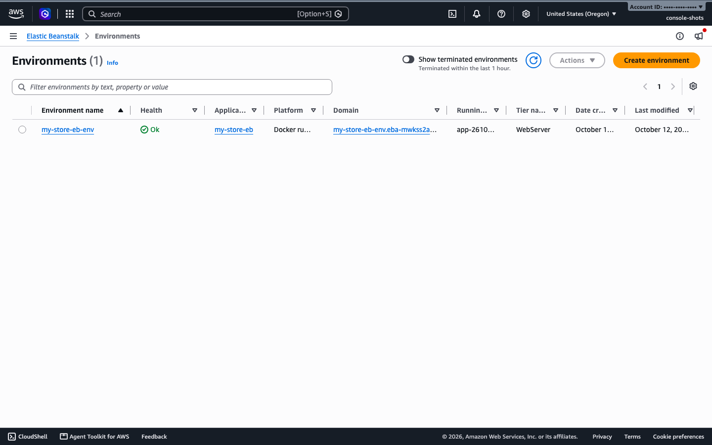
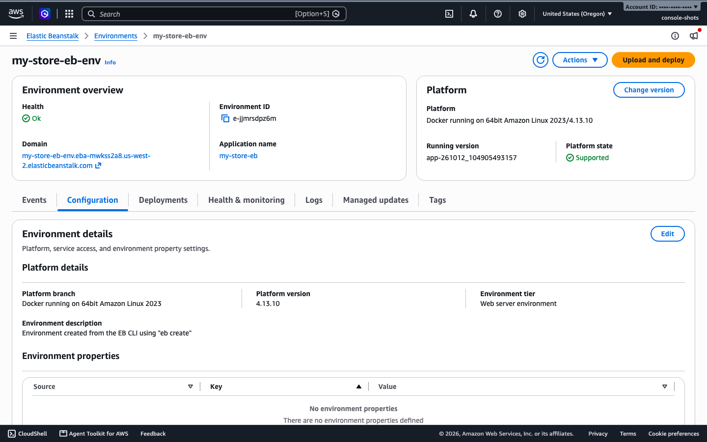

# Project 1: Single-tier store

Deploy a one-page store to Elastic Beanstalk from a public Docker Hub image. You upload one small file. There is no database, no ZIP and no Dockerfile to upload.

## At a glance

| | |
|---|---|
| App | "Nova" store, Flask and gunicorn |
| Source | https://github.com/LondheShubham153/e-commerce-github-actions |
| Image | `trainwithshubham/e-commerce-python:1.1.0` (amd64 and arm64) |
| Platform | Docker on 64bit Amazon Linux 2023 |
| Time | About 3 minutes (Standard), about 22 minutes for your first Cluster Mode environment |
| You need | The tools from [setup/README.md](../setup/README.md) and the [IAM roles](../setup/iam-roles.md) |

Pick one way to run it: [Console](#run-it-with-the-console), [EB CLI](#run-it-with-the-eb-cli) (shortest) or [AWS CLI](#run-it-with-the-aws-cli). Then [check it](#check-it-works) and [clean up](#clean-up).

## 1. Get the file

`beanstalk/docker-compose.yml` is the only file you upload:

```yaml
services:
  app:
    image: trainwithshubham/e-commerce-python:1.1.0
    ports:
      - "80:8080"
    restart: unless-stopped
```

```bash
curl -O https://raw.githubusercontent.com/LondheShubham153/e-commerce-github-actions/main/beanstalk/docker-compose.yml
```

## Run it with the console

1. Open Elastic Beanstalk and choose **Create environment**.
2. Deployment mode **Standard**. Give the application and environment a name.
3. Platform **Docker**, on 64bit Amazon Linux 2023, recommended version.
4. Application code **Local file**, then choose `docker-compose.yml`.
5. Service access: pick `aws-elasticbeanstalk-service-role` and `aws-elasticbeanstalk-ec2-role`.
6. Leave the rest at the defaults and choose **Create environment**.

When it finishes, the Environments list shows the new environment with health **Ok**:



Open it to see the overview and the Events tab, which records each launch step:


The Configuration tab shows the platform, service access and environment properties:



Console labels can differ slightly from this list. The console steps were not hand-clicked for this guide, while the two CLI routes below were run for real.

## Run it with the EB CLI

The shortest route. It reads `docker-compose.yml` from your folder and uploads it for you. Tested with EB CLI 3.27.3 in `us-west-2`.

Install it once, as shown in [setup step 5](../setup/README.md#5-install-the-eb-cli), and check it with `eb --version`.

Deploy from a new empty folder:

```bash
mkdir my-store-eb && cd my-store-eb
curl -O https://raw.githubusercontent.com/LondheShubham153/e-commerce-github-actions/main/beanstalk/docker-compose.yml
eb init my-store-eb --platform docker --region us-west-2
eb create my-store-eb-env --single --instance-type t3.micro \
  --instance_profile aws-elasticbeanstalk-ec2-role \
  --service-role aws-elasticbeanstalk-service-role
```

It was Ready and Green in about 2 minutes. The CLI packs your folder behind the scenes, so you never handle a ZIP.

Handy commands from the same folder:

```bash
eb status        # status, health and URL
eb health        # instance-level health
eb deploy        # push a changed docker-compose.yml as a new version (about 25 seconds)
```

`eb logs` failed on the test machine with a certificate error from the local Python install, so it is not covered here.

## Run it with the AWS CLI

No extra tools. The same deployment in plain commands, tested in `us-west-2`. It creates a single-instance environment on a `t3.micro`.

```bash
BUCKET=$(aws elasticbeanstalk create-storage-location --query S3Bucket --output text)
aws s3 cp docker-compose.yml s3://$BUCKET/my-store/docker-compose-1.yml
aws elasticbeanstalk create-application --application-name my-store
aws elasticbeanstalk create-application-version --application-name my-store \
  --version-label v1 --source-bundle S3Bucket=$BUCKET,S3Key=my-store/docker-compose-1.yml
aws elasticbeanstalk create-environment --application-name my-store \
  --environment-name my-store-env --version-label v1 \
  --solution-stack-name "64bit Amazon Linux 2023 v4.13.10 running Docker" \
  --option-settings \
    Namespace=aws:autoscaling:launchconfiguration,OptionName=IamInstanceProfile,Value=aws-elasticbeanstalk-ec2-role \
    Namespace=aws:elasticbeanstalk:environment,OptionName=ServiceRole,Value=aws-elasticbeanstalk-service-role \
    Namespace=aws:elasticbeanstalk:environment,OptionName=EnvironmentType,Value=SingleInstance \
    Namespace=aws:ec2:instances,OptionName=InstanceTypes,Value=t3.micro
```

The platform name changes with each release. List the current ones with `aws elasticbeanstalk list-available-solution-stacks`.

## Check it works

The environment took about 2.5 minutes to reach Ready and Green.

```bash
aws elasticbeanstalk describe-environments --application-name my-store \
  --query 'Environments[0].[Status,Health,CNAME]' --output text
curl -i http://<your-environment-cname>/health   # {"status":"ok"}
```

Open the environment URL and the store loads. In the console, look at the **Events** tab and **Deployment history** too.


## Clean up

Do this when you finish, or the environment keeps costing money.

```bash
# EB CLI route, from your project folder
eb terminate my-store-eb-env --force
aws elasticbeanstalk delete-application --application-name my-store-eb

# AWS CLI route
aws elasticbeanstalk terminate-environment --environment-name my-store-env
aws elasticbeanstalk wait environment-terminated --environment-names my-store-env
aws elasticbeanstalk delete-application --application-name my-store
```

## Same image on Cluster Mode

Cluster Mode takes the image itself, so there is no compose file. Elastic Beanstalk pulls it from Docker Hub (public) or Amazon ECR. Tested in `us-west-2` with the same image.

The Cluster Mode roles are separate from the two in the setup page. The console picks them for you. On the CLI, pass their ARNs:

```bash
CL=$(aws iam get-role --role-name aws-elasticbeanstalk-eks-cluster-role --query Role.Arn --output text)
ND=$(aws iam get-role --role-name aws-elasticbeanstalk-eks-node-role --query Role.Arn --output text)
OB=$(aws iam get-role --role-name aws-elasticbeanstalk-eks-observability-role --query Role.Arn --output text)

aws elasticbeanstalk create-application --application-name my-store-cluster
aws elasticbeanstalk create-application-version --application-name my-store-cluster \
  --version-label store-1-1-0 \
  --image-configuration Source={Uri=trainwithshubham/e-commerce-python:1.1.0}
aws elasticbeanstalk create-environment --application-name my-store-cluster \
  --environment-name my-store-cluster-env --version-label store-1-1-0 \
  --tier Name=Cluster,Type=EKS \
  --option-settings \
    Namespace=aws:elasticbeanstalk:eks,OptionName=cluster-role,Value=$CL \
    Namespace=aws:elasticbeanstalk:eks,OptionName=node-role,Value=$ND \
    Namespace=aws:elasticbeanstalk:eks:environment,OptionName=observability-role,Value=$OB
```

The store listens on 8080, the default service port, so no port setting is needed. The EB CLI has no Cluster Mode option, so use the AWS CLI or the console.

What to expect:

- The first Cluster Mode environment in a region took about 22 minutes. It also creates shared infrastructure that later environments reuse. The next one (Project 2) took about 3 minutes.
- The load balancer answers on **HTTPS only**. Open `https://<your-environment-cname>/`. Plain `http://` gets no answer.
- `/` and `/health` both returned 200.

Clean up:

```bash
aws elasticbeanstalk terminate-environment --environment-name my-store-cluster-env
aws elasticbeanstalk wait environment-terminated --environment-names my-store-cluster-env
aws elasticbeanstalk delete-application --application-name my-store-cluster
```

Deleting the shared infrastructure can take up to 3 hours after your last Cluster Mode environment ends, and charges continue until it is gone. Check again the next day.

## Common problems

- Build your own image for amd64 and arm64 (`docker buildx build --platform linux/amd64,linux/arm64`), or an instance cannot run it. This matters on Apple silicon Macs.
- Pin the image tag, as the compose file does. `latest` can change under you.
- Leave Version label blank in the console. AWS generates one.
- Wait for Green before you share the URL.
- `delete-application` fails right after `terminate-environment`. Wait for termination first.
