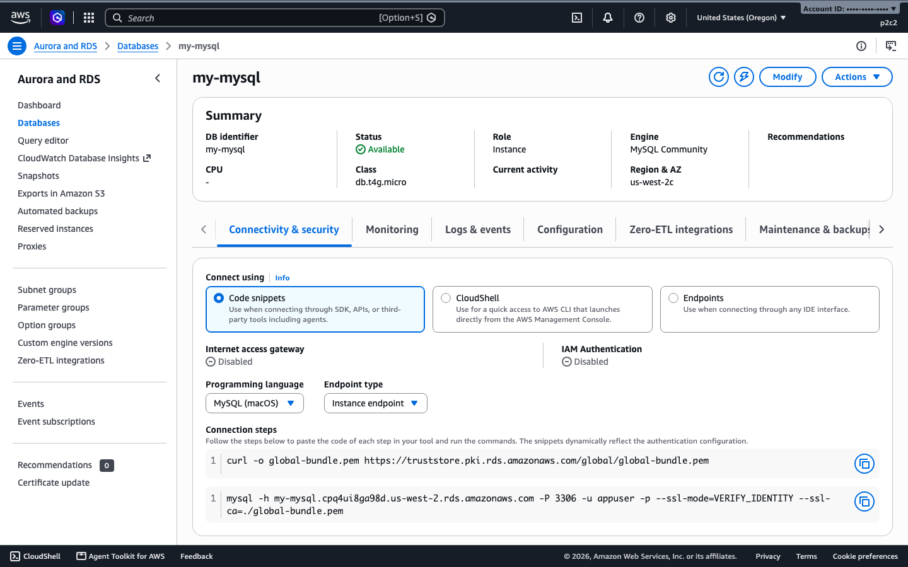
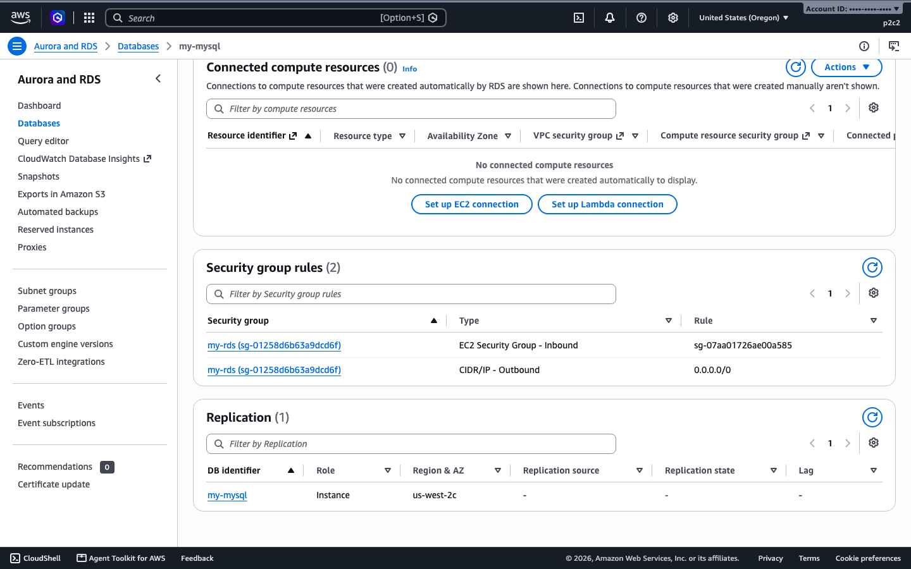
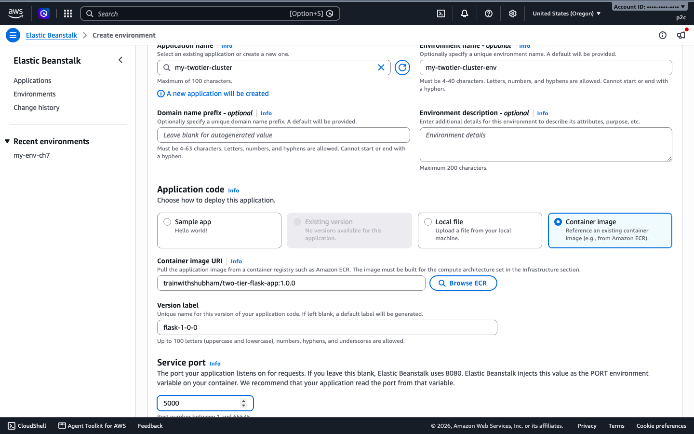
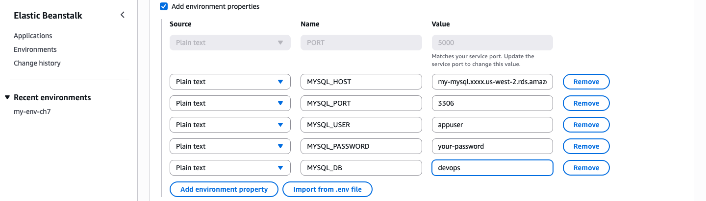
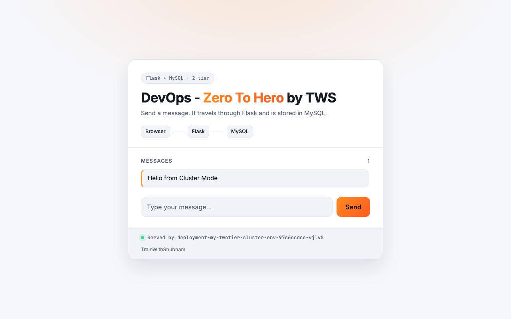
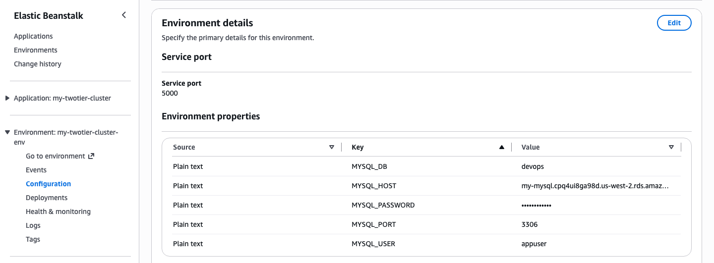

# Project 2: Two-tier Flask and MySQL app

A Flask app that stores messages in MySQL. You deploy it twice: on Standard Mode with MySQL in a container, then on Cluster Mode with the database on Amazon RDS.

## At a glance

| | |
|---|---|
| App | Flask. `/` shows messages and the server that answered, `/health` returns `{"status":"ok"}`, port 5000 |
| Source | https://github.com/LondheShubham153/two-tier-flask-app |
| Image | `trainwithshubham/two-tier-flask-app:1.0.0` (amd64 and arm64) |
| Database settings | `MYSQL_HOST`, `MYSQL_PORT`, `MYSQL_USER`, `MYSQL_PASSWORD`, `MYSQL_DB` (environment variables) |
| Time | About 3 minutes (Standard), about 3 minutes for the Cluster Mode environment once shared infrastructure exists |
| You need | The tools from [setup/README.md](../setup/README.md) and the [IAM roles](../setup/iam-roles.md) |

| Mode | Database | What you give Elastic Beanstalk |
|------|----------|--------------------------------|
| Standard | MySQL container | `beanstalk/docker-compose.yml` from the repo |
| Cluster | Amazon RDS for MySQL | The Docker Hub image, service port 5000, database settings as environment variables |

Cluster Mode runs one container image, so a compose file does not apply there and the database has to live outside.

## Part A: Standard Mode

### 1. Get the file

The compose file starts the app on port 80 and a MySQL 8.4 container with health checks. The app waits until MySQL is healthy.

```bash
curl -O https://raw.githubusercontent.com/LondheShubham153/two-tier-flask-app/master/beanstalk/docker-compose.yml
```

The passwords in that file are placeholders (`change-me-...`). Change them before using this for anything real.

Use a **`t3.small`** or larger. On a `t3.micro` the instance stopped responding while MySQL and Flask started, and the deployment timed out after about 15 minutes. On a `t3.small` it was Ready and Green in about 3.5 minutes.

### 2. Run it

**Console.** Create environment, Standard, platform Docker (Amazon Linux 2023), Local file `docker-compose.yml`, service role `aws-elasticbeanstalk-service-role` and instance profile `aws-elasticbeanstalk-ec2-role`. Under capacity, choose instance type `t3.small`. The console steps were not hand-clicked for this guide.

**EB CLI.** The shortest route. Install the EB CLI as shown in [setup step 5](../setup/README.md#5-install-the-eb-cli). Tested with EB CLI 3.27.3 in `us-west-2`.

```bash
mkdir my-twotier-eb && cd my-twotier-eb
curl -O https://raw.githubusercontent.com/LondheShubham153/two-tier-flask-app/master/beanstalk/docker-compose.yml
eb init my-twotier-eb --platform docker --region us-west-2
eb create my-twotier-eb-env --single --instance-type t3.small \
  --instance_profile aws-elasticbeanstalk-ec2-role \
  --service-role aws-elasticbeanstalk-service-role
```

Ready and Green in about 2.5 minutes. `eb status` shows the URL.

**AWS CLI.** Plain commands, no extra tools.

```bash
BUCKET=$(aws elasticbeanstalk create-storage-location --query S3Bucket --output text)
aws s3 cp docker-compose.yml s3://$BUCKET/my-twotier/docker-compose-1.yml
aws elasticbeanstalk create-application --application-name my-twotier
aws elasticbeanstalk create-application-version --application-name my-twotier \
  --version-label v1 --source-bundle S3Bucket=$BUCKET,S3Key=my-twotier/docker-compose-1.yml
aws elasticbeanstalk create-environment --application-name my-twotier \
  --environment-name my-twotier-env --version-label v1 \
  --solution-stack-name "64bit Amazon Linux 2023 v4.13.10 running Docker" \
  --option-settings \
    Namespace=aws:autoscaling:launchconfiguration,OptionName=IamInstanceProfile,Value=aws-elasticbeanstalk-ec2-role \
    Namespace=aws:elasticbeanstalk:environment,OptionName=ServiceRole,Value=aws-elasticbeanstalk-service-role \
    Namespace=aws:elasticbeanstalk:environment,OptionName=EnvironmentType,Value=SingleInstance \
    Namespace=aws:ec2:instances,OptionName=InstanceTypes,Value=t3.small
```

### 3. Check it works

`/` and `/health` returned 200, and a message posted to `/submit` was stored in MySQL and shown on `/`.


```bash
curl -s -o /dev/null -w "%{http_code}\n" http://<your-environment-cname>/health
curl -s -X POST -d "new_message=hello" http://<your-environment-cname>/submit
```

### 4. Clean up

```bash
# EB CLI route, from your project folder
eb terminate my-twotier-eb-env --force
aws elasticbeanstalk delete-application --application-name my-twotier-eb

# AWS CLI route
aws elasticbeanstalk terminate-environment --environment-name my-twotier-env
aws elasticbeanstalk wait environment-terminated --environment-names my-twotier-env
aws elasticbeanstalk delete-application --application-name my-twotier
```

## Part B: Cluster Mode with RDS

The EB CLI has no Cluster Mode option, so you create the environment in the console or with the AWS CLI. The database and network steps (1 and 2) use the AWS CLI for both routes. Everything in this part was run on a real account in `us-west-2`, and the console pages in the screenshots are from that same run.

### 1. Create the database

Use a private RDS instance in the same VPC as the environment. These commands create a small MySQL 8.4 instance on a `db.t4g.micro` and let only the environment's security group reach port 3306.

```bash
export AWS_REGION=us-west-2
DBPW=$(openssl rand -hex 12)            # keep this, you need it again in step 3
VPC=$(aws ec2 describe-vpcs --filters Name=isDefault,Values=true --query 'Vpcs[0].VpcId' --output text)
SUBNETS=$(aws ec2 describe-subnets --filters Name=vpc-id,Values=$VPC --query 'Subnets[].SubnetId' --output json)

aws rds create-db-subnet-group --db-subnet-group-name my-rds \
  --db-subnet-group-description "RDS for project 2" --subnet-ids "$SUBNETS"
DBSG=$(aws ec2 create-security-group --group-name my-rds --description "RDS for project 2" \
  --vpc-id $VPC --query GroupId --output text)

aws rds create-db-instance --db-instance-identifier my-mysql \
  --db-instance-class db.t4g.micro --engine mysql --allocated-storage 20 --storage-type gp3 \
  --master-username appuser --master-user-password "$DBPW" --db-name devops \
  --db-subnet-group-name my-rds --vpc-security-group-ids $DBSG \
  --no-publicly-accessible --backup-retention-period 0
aws rds wait db-instance-available --db-instance-identifier my-mysql
```

The database took a few minutes to become available. The subnet list is passed as JSON so the same command works in bash and zsh. In the RDS console, open **Databases**, then `my-mysql`: the status is **Available** and the connection details show the endpoint you need in step 3.



### 2. Let the environment reach the database

Cluster Mode creates its own security group when the first environment is built. Create the Project 1 Cluster Mode environment first, which also builds that shared infrastructure, then read the group from it:

```bash
CLUSTER=$(aws eks list-clusters --query 'clusters[0]' --output text)
ENVSG=$(aws eks describe-cluster --name $CLUSTER --query 'cluster.resourcesVpcConfig.clusterSecurityGroupId' --output text)
aws ec2 authorize-security-group-ingress --group-id $DBSG --protocol tcp --port 3306 --source-group $ENVSG
```

On the RDS page, the **Security group rules** section now lists an inbound rule from the environment's group next to the default outbound rule.



**Using a database you already have?** Do the same thing for it. Find its security group, then add the rule for the environment's group:

```bash
aws rds describe-db-instances --db-instance-identifier <your-db> \
  --query 'DBInstances[0].VpcSecurityGroups[].VpcSecurityGroupId' --output text
aws ec2 authorize-security-group-ingress --group-id <that-group> --protocol tcp --port 3306 --source-group $ENVSG
```

An existing database often sits in the VPC's `default` security group, whose only inbound rule is from itself. That group does not let the environment in. See [the failed launch below](#the-launch-fails-with-targettimeout).

### 3. Create the environment

**Run it with the console**

1. Open Elastic Beanstalk and choose **Create environment**. Under **Deployment mode**, choose **Cluster**.
2. Enter the application name `my-twotier-cluster` and the environment name `my-twotier-cluster-env`.
3. Under **Application code**, choose **Container image**. Enter `trainwithshubham/two-tier-flask-app:1.0.0` as the **Container image URI**, a version label such as `flask-1-0-0`, and set **Service port** to `5000`.



4. Under **Environment properties**, tick **Add environment properties** and add `MYSQL_HOST` (your RDS endpoint), `MYSQL_PORT`, `MYSQL_USER`, `MYSQL_PASSWORD` and `MYSQL_DB`. The `PORT` row is filled in for you and follows the service port.



5. Under **Service access**, choose the cluster, node and observability roles. If they do not exist yet, choose **Create new role** next to each one. The console fills in the name and policies, and it is best to keep them.
6. Leave the other sections at their defaults and choose **Create**.

The screenshots show the wizard filled in with placeholder values (the host name is shortened and the password is `your-password`). I did not click **Create** in the console, and I did not pick the three roles in it, because the session I used for screenshots cannot list IAM roles. The environment itself was created with the AWS CLI below.

**Run it with the AWS CLI**

All variables go in one JSON option called `env-variables`. Setting them one by one under `aws:elasticbeanstalk:application:environment` is rejected in Cluster Mode. The options are passed from a file because of the JSON.

```bash
DBHOST=$(aws rds describe-db-instances --db-instance-identifier my-mysql \
  --query 'DBInstances[0].Endpoint.Address' --output text)
CL=$(aws iam get-role --role-name aws-elasticbeanstalk-eks-cluster-role --query Role.Arn --output text)
ND=$(aws iam get-role --role-name aws-elasticbeanstalk-eks-node-role --query Role.Arn --output text)
OB=$(aws iam get-role --role-name aws-elasticbeanstalk-eks-observability-role --query Role.Arn --output text)

python3 - <<PY > opts.json
import json
env = {"MYSQL_HOST": "$DBHOST", "MYSQL_PORT": "3306", "MYSQL_USER": "appuser",
       "MYSQL_PASSWORD": "$DBPW", "MYSQL_DB": "devops"}
print(json.dumps([
  {"Namespace": "aws:elasticbeanstalk:eks", "OptionName": "cluster-role", "Value": "$CL"},
  {"Namespace": "aws:elasticbeanstalk:eks", "OptionName": "node-role", "Value": "$ND"},
  {"Namespace": "aws:elasticbeanstalk:eks:environment", "OptionName": "observability-role", "Value": "$OB"},
  {"Namespace": "aws:elasticbeanstalk:eks:environment", "OptionName": "service-port", "Value": "5000"},
  {"Namespace": "aws:elasticbeanstalk:eks:environment", "OptionName": "env-variables", "Value": json.dumps(env)},
]))
PY

aws elasticbeanstalk create-application --application-name my-twotier-cluster
aws elasticbeanstalk create-application-version --application-name my-twotier-cluster \
  --version-label flask-1-0-0 --image-configuration Source={Uri=trainwithshubham/two-tier-flask-app:1.0.0}
aws elasticbeanstalk create-environment --application-name my-twotier-cluster \
  --environment-name my-twotier-cluster-env --version-label flask-1-0-0 \
  --tier Name=Cluster,Type=EKS --option-settings file://opts.json
```

`opts.json` now holds the database password. Do not commit it.

### 4. Check it works

The environment joined existing shared infrastructure and took about 3 minutes to turn Ready and Green.

```bash
aws elasticbeanstalk describe-environments --application-name my-twotier-cluster \
  --query 'Environments[0].[Status,Health,HealthStatus,CNAME]' --output text
curl -s -o /dev/null -w "%{http_code}\n" https://<your-environment-cname>/health
curl -s -X POST -d "new_message=hello" https://<your-environment-cname>/submit
```

The URL answers on HTTPS only. `/` and `/health` returned 200, and a message posted to `/submit` was stored in RDS and showed up on `/`.



In the console, open the environment and choose the **Configuration** tab. **Environment details** shows the service port and the five properties (the console hides the password value in this screenshot).



### 5. Passwords

`env-variables` stores the password as plain text in the environment configuration. That is fine for a demo. For anything real, use the `secrets` option, which reads from AWS Secrets Manager and needs an application role. This path was not tested here.

### 6. Clean up

```bash
aws elasticbeanstalk terminate-environment --environment-name my-twotier-cluster-env
aws elasticbeanstalk wait environment-terminated --environment-names my-twotier-cluster-env
aws elasticbeanstalk delete-application --application-name my-twotier-cluster
aws rds delete-db-instance --db-instance-identifier my-mysql --skip-final-snapshot
aws rds wait db-instance-deleted --db-instance-identifier my-mysql
aws ec2 delete-security-group --group-id $DBSG
aws rds delete-db-subnet-group --db-subnet-group-name my-rds
```

Terminate your Project 1 Cluster Mode environment too. The shared infrastructure goes up to 3 hours after the last Cluster Mode environment ends, and charges continue until then.

## The launch fails with Target.Timeout

**What you see.** The environment stays Grey, then ends in `Failed to launch environment`. The Events tab fills with a warning every few seconds:

```
targetGroupArn='...' has '1' unhealthy targets due to ['target='...' is in state='unhealthy' due to reason='Target.Timeout' description='Request timed out'']
```

followed by `Application failed to start within the expected time`, `Deployment failed, pending rollback` and `Rollback skipped as no previous successful deployment found`.

**Why.** The load balancer checks `/` on your app, and the home page queries MySQL. If the app cannot reach the database, the query hangs until the check times out. The image, the service port and the other settings can all be right.

The usual cause is the database security group. It has no inbound rule on port 3306 from the environment's security group (step 2). This was the exact cause when we looked at a real failed environment: the database was in the VPC `default` security group, with a single inbound rule from itself.

**Check it.**

```bash
aws elasticbeanstalk describe-events --environment-name <your-env> --max-items 10 \
  --query 'Events[].[Severity,Message]' --output text

# the database's security group and its inbound rules
DBSG=$(aws rds describe-db-instances --db-instance-identifier <your-db> \
  --query 'DBInstances[0].VpcSecurityGroups[0].VpcSecurityGroupId' --output text)
aws ec2 describe-security-groups --group-ids $DBSG --query 'SecurityGroups[0].IpPermissions'

# the environment's security group
CLUSTER=$(aws eks list-clusters --query 'clusters[0]' --output text)
aws eks describe-cluster --name $CLUSTER --query 'cluster.resourcesVpcConfig.clusterSecurityGroupId' --output text
```

If no inbound rule on port 3306 lists that last group, the database cannot be reached.

**Fix it.** Add the rule from step 2, then recreate the environment, because a failed launch does not recover on its own. Terminate it and create it again, or choose **Rebuild environment** in the console.

```bash
aws ec2 authorize-security-group-ingress --group-id $DBSG --protocol tcp --port 3306 --source-group <environment-security-group>
```

Other things that give the same symptom: a wrong host name, user, password or database name in `env-variables`, or a database in a different VPC. Check those if the rule is already in place.

I diagnosed this on a real failed environment. The rule command is the same one tested in step 2. I did not rebuild that environment to confirm it recovers.

## Common problems

- `t3.micro` hangs on the MySQL plus Flask compose file. Use `t3.small`.
- On Cluster Mode the service port must be 5000.
- The RDS security group must allow the environment's security group on port 3306. If it does not, the launch fails with `Target.Timeout` ([details](#the-launch-fails-with-targettimeout)).
- Use one `env-variables` JSON option on Cluster Mode, not one option per variable.
- Never commit a real database password. The compose file's `change-me-...` values are placeholders.
- On zsh (the macOS default), an unquoted `$SUBNETS` made up of several lines is not split into words. Pass it as JSON in quotes, as in step 1.
- The "Served by" line on the home page shows the name of the container host, and it looks different on each mode.
