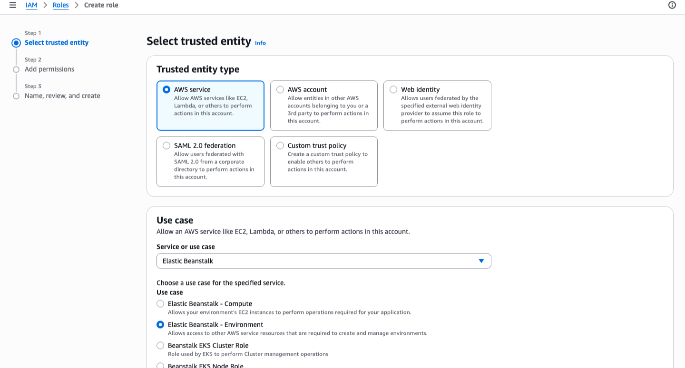
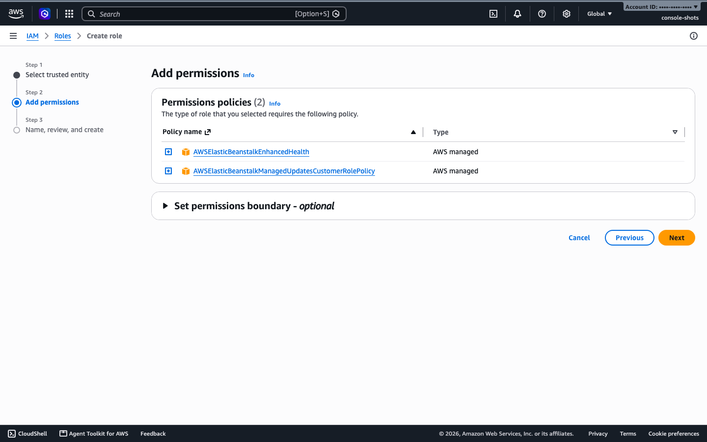
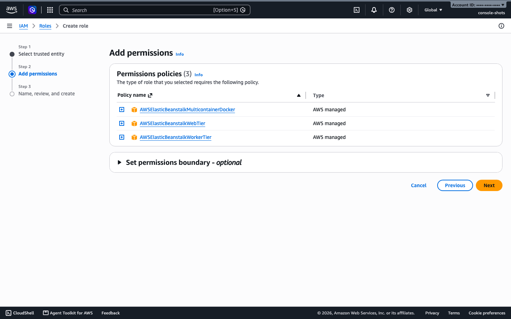
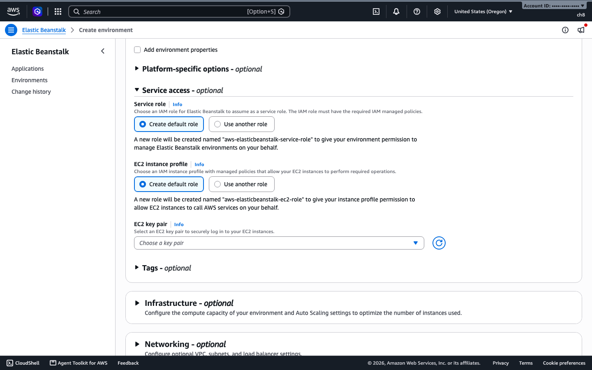

# Create the IAM roles (do this before Elastic Beanstalk)

This is the last step of the [setup](README.md). Do the tools and sign-in steps there first.

Standard Mode needs two IAM roles in your AWS account before it can create an environment. The simplest habit is to create them first, then open Elastic Beanstalk.

The Standard Mode wizard can also make them for you. On its Service access step, both **Service role** and **EC2 instance profile** default to **Create default role**, which creates `aws-elasticbeanstalk-service-role` and `aws-elasticbeanstalk-ec2-role`, the same names used here. We still recommend creating them yourself first, for three reasons: the EB CLI and AWS CLI routes need the roles to exist already, you can see exactly what was created, and the wizard fails if your IAM user is not allowed to create roles. The Cluster Mode wizard has no default option. It asks you to choose its roles and sends you to IAM through **Create new role**.

The order is:

1. Create the two roles (this page, about 2 minutes).
2. Open Elastic Beanstalk and create your environment.
3. On the Service access step, choose **Use another role** and pick the two roles, or leave **Create default role** if they already exist under the same names.

You only do this once per AWS account. Cluster Mode uses its own roles, and the console selects those for you.

## What the two roles do

| Role | Who uses it | What it allows |
|------|-------------|----------------|
| `aws-elasticbeanstalk-service-role` | Elastic Beanstalk itself | Health monitoring and managed updates for your environment |
| `aws-elasticbeanstalk-ec2-role` (plus an instance profile with the same name) | The instances that run your app | Writing logs, and talking to Elastic Beanstalk |

Both use policies that AWS maintains, so you do not write any permissions yourself.

## Create them in the console

Open the IAM console, then **Roles**, then **Create role**. You make two roles, one after the other.

**Role 1: the service role**

1. **Trusted entity type**: AWS service.
2. **Service or use case**: Elastic Beanstalk. Under **Use case**, choose **Elastic Beanstalk - Environment**. Choose **Next**.

   
3. Check that the permissions list shows `AWSElasticBeanstalkEnhancedHealth` and `AWSElasticBeanstalkManagedUpdatesCustomerRolePolicy`. Choose **Next**.

   
4. **Role name**: `aws-elasticbeanstalk-service-role`.
5. Choose **Create role**.

**Role 2: the instance role**

1. Choose **Create role** again. **Trusted entity type**: AWS service.
2. **Service or use case**: Elastic Beanstalk, then the **Elastic Beanstalk - Compute** use case. Choose **Next**.

   
3. Check that the permissions list shows `AWSElasticBeanstalkWebTier`, `AWSElasticBeanstalkWorkerTier` and `AWSElasticBeanstalkMulticontainerDocker`. Choose **Next**.

   
4. **Role name**: `aws-elasticbeanstalk-ec2-role`.
5. Choose **Create role**.

The use case list has other options too. Stick to the two above, which attach the right policies for you. The console creates the instance profile for you, with the same name as the role.

Back on the **Roles** page, search for `aws-elasticbeanstalk` and you should see both roles.

The screenshots come from walking the Create role wizard on a real account (stopping before **Create role**, since these roles already existed there). The steps follow the AWS documentation for [service roles](https://docs.aws.amazon.com/elasticbeanstalk/latest/dg/iam-servicerole.html) and [instance profiles](https://docs.aws.amazon.com/elasticbeanstalk/latest/dg/iam-instanceprofile.html). Button labels can shift a little. The CLI commands below were run for real. If the console steps do not match what you see, use the CLI route.

## Create them with the AWS CLI

Sign in as an IAM user or role that can create roles. Do not use the root user. The commands were run against a real account.

```bash
cat > eb-trust.json <<'EOF'
{"Version":"2012-10-17","Statement":[{"Effect":"Allow","Principal":{"Service":"elasticbeanstalk.amazonaws.com"},"Action":"sts:AssumeRole"}]}
EOF

cat > ec2-trust.json <<'EOF'
{"Version":"2012-10-17","Statement":[{"Effect":"Allow","Principal":{"Service":"ec2.amazonaws.com"},"Action":"sts:AssumeRole"}]}
EOF

# Service role
aws iam create-role --role-name aws-elasticbeanstalk-service-role \
  --assume-role-policy-document file://eb-trust.json
aws iam attach-role-policy --role-name aws-elasticbeanstalk-service-role \
  --policy-arn arn:aws:iam::aws:policy/service-role/AWSElasticBeanstalkEnhancedHealth
aws iam attach-role-policy --role-name aws-elasticbeanstalk-service-role \
  --policy-arn arn:aws:iam::aws:policy/AWSElasticBeanstalkManagedUpdatesCustomerRolePolicy

# Instance role and instance profile
aws iam create-role --role-name aws-elasticbeanstalk-ec2-role \
  --assume-role-policy-document file://ec2-trust.json
for p in AWSElasticBeanstalkWebTier AWSElasticBeanstalkWorkerTier AWSElasticBeanstalkMulticontainerDocker; do
  aws iam attach-role-policy --role-name aws-elasticbeanstalk-ec2-role \
    --policy-arn arn:aws:iam::aws:policy/$p
done
aws iam create-instance-profile --instance-profile-name aws-elasticbeanstalk-ec2-role
aws iam add-role-to-instance-profile \
  --instance-profile-name aws-elasticbeanstalk-ec2-role \
  --role-name aws-elasticbeanstalk-ec2-role
```

Check the result:

```bash
aws iam list-attached-role-policies --role-name aws-elasticbeanstalk-service-role
aws iam list-attached-role-policies --role-name aws-elasticbeanstalk-ec2-role
aws iam get-instance-profile --instance-profile-name aws-elasticbeanstalk-ec2-role
```

You should see two policies on the service role, three on the instance role, and the instance role listed inside the instance profile.

## Then open Elastic Beanstalk

On the Service access step of Create environment, choose **Use another role** for both the service role and the EC2 instance profile, then pick `aws-elasticbeanstalk-service-role` and `aws-elasticbeanstalk-ec2-role`. The wizard offers **Create default role** first. If the two roles already exist with these names, you can leave that choice as it is.



I looked at this step but did not create an environment through it, so I did not test what **Create default role** does when the roles already exist.

## Cleaning up

The roles cost nothing, so you can leave them for the next project. Environments are what cost money, so delete those when you finish.
